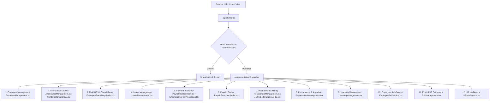

# BusinessOS AI — Complete HRMS Module Technical & Functional Specification

> **System:** BusinessOS AI Enterprise ERP / HRMS  
> **Route Entry Point:** [`frontend/src/routes/_app.hrms.tsx`](file:///c:/Users/admin/Desktop/NewFolder/frontend/src/routes/_app.hrms.tsx)  
> **Backend Router:** [`backend/src/api/v1/router.py`](file:///c:/Users/admin/Desktop/NewFolder/backend/src/api/v1/router.py)  
> **API Client:** [`frontend/src/lib/api-client.ts`](file:///c:/Users/admin/Desktop/NewFolder/frontend/src/lib/api-client.ts)  
> **Database Models:** [`backend/src/models/__init__.py`](file:///c:/Users/admin/Desktop/NewFolder/backend/src/models/__init__.py)

---

## 1. High-Level Architecture & Component Dispatcher

HRMS uses a dynamic tab-query routing pattern (`/hrms?tab=<tab_name>`). All routing decisions and RBAC permission checks are centralized in [`_app.hrms.tsx`](file:///c:/Users/admin/Desktop/NewFolder/frontend/src/routes/_app.hrms.tsx).

---

## 2. Master Navigation & Sub-Tab Inventory

| # | Group | Sub-Tab Query (`?tab=...`) | Frontend Component | Backend File | Primary Database Models |
|---|---|---|---|---|---|
| **1** | Employee Management | `employees` | `EmployeeManagement.tsx` | `hrms/employees.py` | `Employee`, `User` |
| **2** | Employee Management | `departments` | `EmployeeManagement.tsx` | `erp/organization.py` | `Department`, `Company`, `Branch` |
| **3** | Employee Management | `designations` | `EmployeeManagement.tsx` | `erp/organization.py` | `Designation` |
| **4** | Employee Management | `teams` | `EmployeeManagement.tsx` | `erp/organization.py` | `Team` |
| **5** | Employee Management | `documents` | `EmployeeManagement.tsx` | `hrms/employees.py` | `EmployeeDocument` |
| **6** | Employee Management | `employee_profile` | `EmployeeManagement.tsx` | `hrms/employees.py` | `Employee`, `SalaryStructure`, etc. |
| **7** | Employee Management | `org_chart` | `EmployeeManagement.tsx` | `hrms/employees.py` | `Employee`, `Designation` |
| **8** | Attendance | `daily_attendance` | `AttendanceManagement.tsx` | `hrms/attendance.py` | `AttendanceRecord` |
| **9** | Attendance | `attendance_settings` | `AttendanceManagement.tsx` | `hrms/attendance.py` | `AttendanceScheme`, `WorkCalendar` |
| **10**| Attendance | `work_calendars` | `AttendanceManagement.tsx` | `hrms/attendance.py` | `WorkCalendar` |
| **11**| Attendance | `biometric` | `AttendanceManagement.tsx` | `hrms/attendance.py` | `BiometricDevice` |
| **12**| Attendance | `face_recognition` | `AttendanceManagement.tsx` | `hrms/attendance.py` | `FaceRecognitionLog`, `Employee` |
| **13**| Attendance | `gps_attendance` | `AttendanceManagement.tsx` | `hrms/attendance.py` | `AttendanceRecord` |
| **14**| Attendance | `travel_routes` / `travel_route_map` | `EmployeeRouteMapStudio.tsx` | `hrms/travel_routes.py` | `EmployeeLocationTrail` |
| **15**| Attendance | `shift_attendance` | `ShiftRosterCalendar.tsx` | `hrms/attendance.py` | `AttendanceRecord`, `AttendanceScheme` |
| **16**| Attendance | `attendance_corrections` | `AttendanceManagement.tsx` | `hrms/attendance.py` | `AttendanceCorrection` |
| **17**| Leave | `leave_requests` | `LeaveManagement.tsx` | `hrms/leaves.py` | `LeaveRequest` |
| **18**| Leave | `leave_calendar` | `LeaveManagement.tsx` | `hrms/leaves.py` | `LeaveRequest` |
| **19**| Leave | `leave_balance` | `LeaveManagement.tsx` | `hrms/leaves.py` | `LeaveBalance` |
| **20**| Leave | `leave_policies` | `LeaveManagement.tsx` | `hrms/leaves.py` | `LeavePolicy` |
| **21**| Leave | `approvals` | `LeaveManagement.tsx` | `hrms/leaves.py` | `LeaveRequest` |
| **22**| Payroll | `salary_structure` | `PayrollManagement.tsx` | `hrms/payroll.py` | `SalaryStructure` |
| **23**| Payroll | `pay_grades` | `PayrollManagement.tsx` | `hrms/payroll.py` | `PayGrade` |
| **24**| Payroll | `payroll_processing` | `EnterprisePayrollProcessing.tsx` | `hrms/payroll.py` | `Payslip`, `AttendanceRecord` |
| **25**| Payroll | `pf` | `PayrollManagement.tsx` | `hrms/payroll.py` | `SalaryStructure`, `Payslip` |
| **26**| Payroll | `esi` | `PayrollManagement.tsx` | `hrms/payroll.py` | `SalaryStructure`, `Payslip` |
| **27**| Payroll | `tds` | `PayrollManagement.tsx` | `hrms/payroll.py` | `SalaryStructure`, `Payslip` |
| **28**| Payroll | `payslips` | `PayrollManagement.tsx` | `hrms/payroll.py` | `Payslip` |
| **29**| Payroll | `payslip_templates` | `PayslipTemplateStudio.tsx` | `hrms/payroll.py` | `PayslipTemplate` |
| **30**| Payroll | `loans` | `PayrollManagement.tsx` | `hrms/payroll.py` | `EmployeeLoan` |
| **31**| Payroll | `advances` | `PayrollManagement.tsx` | `hrms/payroll.py` | `SalaryAdvance` |
| **32**| Payroll | `bonuses` | `PayrollManagement.tsx` | `hrms/payroll.py` | `EmployeeBonus` |
| **33**| Payroll | `commissions` | `PayrollManagement.tsx` | `hrms/payroll.py` | `SalesCommission`, `CommissionSlabPlan` |
| **34**| Recruitment | `job_openings` | `RecruitmentManagement.tsx` | `hrms/recruitment.py` | `JobOpening` |
| **35**| Recruitment | `applicants` | `RecruitmentManagement.tsx` | `hrms/recruitment.py` | `Applicant` |
| **36**| Recruitment | `interviews` | `RecruitmentManagement.tsx` | `hrms/recruitment.py` | `Interview` |
| **37**| Recruitment | `offer_letters` | `OfferLetterStudioModal.tsx` | `hrms/recruitment.py` | `OfferLetter` |
| **38**| Recruitment | `onboarding` | `RecruitmentManagement.tsx` | `hrms/recruitment.py` | `OnboardingRecord` |
| **39**| Performance | `goals` | `PerformanceManagement.tsx` | `hrms/performance.py` | `PerformanceGoal` |
| **40**| Performance | `kpis` | `PerformanceManagement.tsx` | `hrms/performance.py` | `PerformanceKpi` |
| **41**| Performance | `appraisals` | `PerformanceManagement.tsx` | `hrms/performance.py` | `PerformanceAppraisal` |
| **42**| Performance | `performance_reviews` | `PerformanceManagement.tsx` | `hrms/performance.py` | `PerformanceAppraisal` |
| **43**| Performance | `incentives` | `PerformanceManagement.tsx` | `hrms/performance.py` | `PerformanceIncentive` |
| **44**| Learning | `training` / `courses` | `LearningManagement.tsx` | `hrms/learning.py` | `LearningCourse` |
| **45**| Learning | `certificates` | `LearningManagement.tsx` | `hrms/learning.py` | `LearningCertificate` |
| **46**| Learning | `assessments` | `LearningManagement.tsx` | `hrms/learning.py` | `LearningAssessment` |
| **47**| Employee Self-Service | `ess_attendance` | `EmployeeSelfService.tsx` | `hrms/attendance.py` | `AttendanceRecord` |
| **48**| Employee Self-Service | `ess_leaves` | `EmployeeSelfService.tsx` | `hrms/leaves.py` | `LeaveRequest`, `LeaveBalance` |
| **49**| Employee Self-Service | `ess_payroll` | `EmployeeSelfService.tsx` | `hrms/payroll.py` | `Payslip` |
| **50**| Employee Self-Service | `ess_documents` | `EmployeeSelfService.tsx` | `hrms/employees.py` | `EmployeeDocument` |
| **51**| Employee Self-Service | `ess_tasks` | `EmployeeSelfService.tsx` | `hrms/recruitment.py` | `OnboardingRecord` |
| **52**| Employee Self-Service | `ess_performance` | `EmployeeSelfService.tsx` | `hrms/performance.py` | `PerformanceGoal`, `PerformanceAppraisal` |
| **53**| Employee Self-Service | `ess_learning` | `EmployeeSelfService.tsx` | `hrms/learning.py` | `LearningCourse` |
| **54**| Employee Self-Service | `ess_announcements`| `EmployeeSelfService.tsx` | `notifications.py` | `Notification` |
| **55**| Exit Management | `resignation` | `ExitManagement.tsx` | `hrms/exit_management.py` | `ExitResignation` |
| **56**| Exit Management | `clearance` | `ExitManagement.tsx` | `hrms/exit_management.py` | `ExitClearanceTask` |
| **57**| Exit Management | `final_settlement` | `ExitManagement.tsx` | `hrms/exit_management.py` | `ExitFinalSettlement` |
| **58**| Exit Management | `experience_letter`| `ExitManagement.tsx` | `hrms/exit_management.py` | `ExitExperienceLetter` |
| **59**| HR Intelligence | `attendance_analytics`| `HRIntelligence.tsx` | `hrms/intelligence.py` | Aggregated Attendance |
| **60**| HR Intelligence | `payroll_analytics` | `HRIntelligence.tsx` | `hrms/intelligence.py` | Aggregated Payroll |
| **61**| HR Intelligence | `attrition_prediction`| `HRIntelligence.tsx` | `hrms/intelligence.py` | Predictive ML / Heuristic |
| **62**| HR Intelligence | `shift_optimization` | `HRIntelligence.tsx` | `hrms/intelligence.py` | Roster Optimization |
| **63**| HR Intelligence | `productivity_score`| `HRIntelligence.tsx` | `hrms/intelligence.py` | Tasks & Deals Velocity |
| **64**| HR Intelligence | `training_recommendation`| `HRIntelligence.tsx` | `hrms/intelligence.py` | Skill Gap Matrix |

---

## 3. Exhaustive Sub-Tab Functional Breakdown

---

### GROUP 1: EMPLOYEE MANAGEMENT
**Component:** [`frontend/src/components/hrms/EmployeeManagement.tsx`](file:///c:/Users/admin/Desktop/NewFolder/frontend/src/components/hrms/EmployeeManagement.tsx)  
**Backend:** [`backend/src/api/v1/hrms/employees.py`](file:///c:/Users/admin/Desktop/NewFolder/backend/src/api/v1/hrms/employees.py) & [`backend/src/api/v1/erp/organization.py`](file:///c:/Users/admin/Desktop/NewFolder/backend/src/api/v1/erp/organization.py)

#### 1.1 `tab=employees` (Employee Master Directory)
- **Data Displayed:** Paginated employee cards/table with Code, Full Name, Email, Phone, Company/Branch, Department, Designation, Status (`Active`, `On Leave`, `Inactive`), Joining Date, Punch Method badge, Sales Points.
- **Buttons & Controls:**
  - `+ Add Employee` (Top Right) &rarr; Opens `Add Employee Modal`.
  - `Bulk Import` (Top Right) &rarr; Opens `Bulk CSV Import Modal`.
  - `Search Input` &rarr; Real-time debounced query filtering across code, name, email.
  - `Department Filter Dropdown` &rarr; Filters list by selected department ID.
  - `Status Filter Dropdown` &rarr; Filters by `Active`, `On Leave`, `Inactive`.
  - `Digital Card / QR (vCard)` (Per Card) &rarr; Opens `vCard Modal`.
  - `Print Badge` (Per Card) &rarr; Opens printable high-res corporate ID badge popup window with barcodes, QR code, and signature lines.
  - `Generate Offer Letter` (Per Card) &rarr; Opens `OfferLetterStudioModal` loaded with the employee's existing details.
  - `Edit (Pencil Icon)` &rarr; Loads employee record into editing dialog.
  - `Delete (Trash Icon)` &rarr; Confirms and deletes employee, revoking user login credentials.
- **Modals & Dialogs:**
  - *Add/Edit Employee Dialog:* Form fields: Employee Code, Full Name, Email, Phone, Employment Type (`Full-Time`, `Part-Time`, `Contract`, `Internship`), Status, Basic Salary, Punch Method (`GPS`, `Biometric`, `Face`, `Web`, `Manual`), NFC Card ID, Company, Branch, Department, Designation, Reporting Manager, Role (RBAC), Multi-Scheme Checkboxes (with Primary scheme radio), Multi-Team Checkboxes.
  - *Temporary Credentials Dialog:* Renders newly created employee's email, employee code, and auto-generated temporary password with a 1-click "Copy Credentials" button.
  - *vCard QR Modal:* Displays vCard QR code, full contact details, and a "Download .VCF File" button.
- **Calculations & Logic:**
  - Phone formatting & validation.
  - Multi-assignment synchronization: loops through schemes and teams, issuing `assign` or `unassign` API requests.

#### 1.2 `tab=departments` (Department Hierarchy)
- **Data Displayed:** Department name, code, parent department, Head of Department (HOD), active staff headcount, sub-divisions count, company/branch name, status.
- **Buttons & Controls:**
  - `Card Grid / Org Hierarchy Tree` toggle buttons &rarr; Switches between card view and collapsible tree hierarchy view.
  - `Create Department` &rarr; Opens `Department Modal`.
  - `Edit Department` &rarr; Loads department details for editing.
  - `Delete Department` &rarr; Prompts confirmation and deletes department.
- **Modals & Dialogs:**
  - *Department Modal:* Name, Code, Company, Branch, Parent Department (recursive hierarchy), HOD (Head of Department selected from employees), Description, Status (`active`/`inactive`).

#### 1.3 `tab=designations` (Designations & Job Titles)
- **Data Displayed:** Designation Title, Code, Level grading (`L1 - Executive`, `L2 - Mid-Level`, `L3 - Senior`, `L4 - Lead / Principal`, `L5 - Management / VP`, `L6 - C-Suite / Executive`), Department, Reports-To Designation, Employee count, Status.
- **Buttons & Controls:**
  - `Table / Org Tree` toggle &rarr; Switches between list table and vertical hierarchy graph.
  - `Create Designation` &rarr; Opens `Designation Modal`.
  - `Edit / Delete` actions.

#### 1.4 `tab=teams` (Operational Teams & Squads)
- **Data Displayed:** Team Name, Code, Department, Team Lead, Member count, Member avatars, Description, Status.
- **Buttons & Controls:**
  - `Create Team` &rarr; Opens `Team Modal`.
  - `Edit Team` &rarr; Opens modal with multi-employee checkbox selector to adjust squad members.
  - `Delete Team` &rarr; Removes team association.

#### 1.5 `tab=documents` (Employee Document Vault)
- **Data Displayed:** Employee selector dropdown, list of documents with Name, Document Type (`Contract`, `ID Proof`, `NDA`, `Compliance`), File Path, Upload Date, Expiry Date, Validity Status (`Valid`, `Expired`).
- **Buttons & Controls:**
  - `Select Employee` &rarr; Loads document list for chosen employee.
  - `Upload Document Form` &rarr; Input for Document Name, Type, and File Path.
  - `Save Document Button` &rarr; Submits `createDocument` payload.
  - `View / Download Document` &rarr; Opens document link.

#### 1.6 `tab=employee_profile` (360-Degree Employee Dossier)
- **Data Displayed:** Employee selector, full personal information, contact cards, emergency contacts, job information, compensation breakdown, attendance statistics, active schemes, uploaded documents, activity audit trail.

#### 1.7 `tab=org_chart` (Interactive Org Chart)
- **Data Displayed:** Visual hierarchy tree mapping reporting relationships from Managing Director / CEO down through Department Heads to Team Leads and Individual Contributors.

---

### GROUP 2: ATTENDANCE & SHIFTS
**Components:**
- [`frontend/src/components/hrms/AttendanceManagement.tsx`](file:///c:/Users/admin/Desktop/NewFolder/frontend/src/components/hrms/AttendanceManagement.tsx)
- [`frontend/src/components/hrms/ShiftRosterCalendar.tsx`](file:///c:/Users/admin/Desktop/NewFolder/frontend/src/components/hrms/ShiftRosterCalendar.tsx)
- [`frontend/src/components/hrms/AttendanceCalendarView.tsx`](file:///c:/Users/admin/Desktop/NewFolder/frontend/src/components/hrms/AttendanceCalendarView.tsx)  
**Backend:** [`backend/src/api/v1/hrms/attendance.py`](file:///c:/Users/admin/Desktop/NewFolder/backend/src/api/v1/hrms/attendance.py)

#### 2.1 `tab=daily_attendance` (Daily Attendance Roster)
- **Data Displayed:** KPI stats: Total Staff, Present Today, Absent Today, Late Arrivals, On Leave. Log table: Date, Employee Name & Code, Check-In time, Check-Out time, Hours Worked, Overtime Hours, Status badge (`Present`, `Late`, `Half Day`, `Absent`, `On Leave`), Method badge (`Biometric`, `Face`, `GPS`, `Web`), IP/Location, Notes.
- **Buttons & Controls:**
  - `Date Picker` &rarr; Filters attendance records by date.
  - `Company Dropdown` &rarr; Filters by organization entity.
  - `Manual Punch Modal Button` &rarr; Records manual check-in/out for exceptional circumstances.
  - `Delete Record` &rarr; Removes incorrect punch log.
- **Calculations:**
  - $\text{Hours Worked} = (\text{Check-Out} - \text{Check-In}) / 3600$
  - $\text{Overtime Hours} = \max(0, \text{Hours Worked} - 8.0)$

#### 2.2 `tab=attendance_settings` & `tab=work_calendars`
- **Sub-Tabs within Settings:**
  1. `work_calendars`:
     - Working days checkboxes (Monday through Sunday).
     - Holiday schedule table with Holiday Name and Date.
     - `Add Holiday Modal` &rarr; Adds paid holidays to calendar.
  2. `schemes` (Attendance Schemes Master):
     - Displays all shift schemes: Shift Name, Code, Shift Start/End (`09:00 - 18:00`), Grace Period (`15 mins`), Half-day (`4.0 hrs`), Full-day (`8.0 hrs`), Overtime Mode, Allowed Punch Methods (`GPS`, `Biometric`, `Face`, `Web`), Geofence coordinates (`lat`, `lng`, `radius`), Status.
     - `Create Scheme Button` &rarr; Opens `Scheme Configuration Modal`.
     - `Assign Scheme Button` &rarr; Opens multi-employee assignment modal with primary/secondary priority and effective dates.

#### 2.3 `tab=biometric` (Biometric Hardware IoT Integration)
- **Data Displayed:** Registered devices table: Device Code, Physical Location, IP Address, Device Model, Enrolled Employees count, Last Sync Timestamp, Status (`Online`, `Offline`).
- **Buttons & Controls:**
  - `Add Biometric Device` &rarr; Registers device hardware credentials.
  - `Sync Devices Now` &rarr; Issues `/hrms/attendance/biometric/sync` to trigger hardware polling.
  - `Delete Device` &rarr; Unlinks hardware.

#### 2.4 `tab=face_recognition` (AI Face Attendance Logs)
- **Data Displayed:** Real-time log table: Employee Photo, Name, Timestamp, Confidence Score % (e.g. `98.4%`), Location, Action (`Check-In` / `Check-Out`), Verification Status (`Verified` / `Failed`).
- **Buttons & Controls:**
  - `Simulate Face Match` &rarr; Tests recognition algorithms.
  - `Enroll Face` &rarr; Activates webcam to store 128-dimensional face embedding descriptor in DB.

#### 2.5 `tab=gps_attendance` (Geofenced GPS Punch Audit)
- **Data Displayed:** Geolocation audit table: Employee, Timestamp, Latitude, Longitude, Accuracy (meters), Geofence Status (`Within Geofence` / `Outside Geofence`), IP Address, Open in Google Maps button.
- **Calculations:** Haversine formula determines distance from scheme center. Punches exceeding radius are flagged.

#### 2.6 `tab=shift_attendance` (Shift Roster Calendar)
- **Rendered by:** [`ShiftRosterCalendar.tsx`](file:///c:/Users/admin/Desktop/NewFolder/frontend/src/components/hrms/ShiftRosterCalendar.tsx)
- **Data Displayed:** Month-view calendar grid plotting employees on Y-axis and days of month on X-axis with shift chips (`Morning 09:00-18:00`, `Evening 14:00-23:00`, `Night 22:00-07:00`, `Off`).
- **Buttons & Controls:**
  - `Month / Year Selector`.
  - `Department Filter`.
  - `Bulk Assign Shift Button` &rarr; Assigns shifts across multiple dates and staff.
  - `Export Roster Button` &rarr; Downloads roster spreadsheet.

#### 2.7 `tab=attendance_corrections` (Regularization Workflow)
- **Data Displayed:** Correction requests table: Employee, Date, Original Punch vs Requested Punch, Reason for discrepancy, Review Status (`Pending`, `Approved`, `Rejected`), Reviewer Name.
- **Buttons & Controls:**
  - `Approve (Checkmark)` &rarr; Updates actual attendance record to requested times and marks request as `Approved`.
  - `Reject (Cross)` &rarr; Marks request as `Rejected` with reviewer explanation.

---

### GROUP 3: FIELD GPS TRAVEL RADAR STUDIO
**Component:** [`frontend/src/components/hrms/EmployeeRouteMapStudio.tsx`](file:///c:/Users/admin/Desktop/NewFolder/frontend/src/components/hrms/EmployeeRouteMapStudio.tsx)  
**Backend:** [`backend/src/api/v1/hrms/travel_routes.py`](file:///c:/Users/admin/Desktop/NewFolder/backend/src/api/v1/hrms/travel_routes.py)  
**Tabs:** `travel_routes`, `travel_route_map`, `field_tracking`

- **Modes:**
  1. `Journey Mode` (Single employee historical travel playback).
  2. `Live Radar Mode` (All on-duty field personnel live map).
- **Controls & Features:**
  - `Employee Selector & Date Picker`.
  - `Leaflet Map View` &rarr; Interactive tiles (OpenStreetMap, CartoDB Positron, Dark Mode, Satellite).
  - `Playback Toolbar`:
    - `Play / Pause Button` &rarr; Starts/pauses route animation.
    - `Fast-Forward (1x, 2x, 5x) Button` &rarr; Adjusts playback animation speed.
    - `Rewind / Reset Button` &rarr; Rewinds marker to starting coordinate.
    - `Timeline Scrubber Slider` &rarr; Drag to any minute of the workday.
  - `Telemetry Panel`: Live Speed ($\text{km/h}$), Distance Traveled ($\text{km}$), Battery Level %, Heading Direction, Altitude, Total Stops / Client Visits.
  - `Simulate Route Button` &rarr; Generates test route breadcrumbs for development/testing.
  - `Clear Route Button` &rarr; Flushes test coordinates.
  - `Map Settings Modal` &rarr; Configures Google Maps / Mapbox API credentials.

---

### GROUP 4: LEAVE MANAGEMENT
**Component:** [`frontend/src/components/hrms/LeaveManagement.tsx`](file:///c:/Users/admin/Desktop/NewFolder/frontend/src/components/hrms/LeaveManagement.tsx)  
**Backend:** [`backend/src/api/v1/hrms/leaves.py`](file:///c:/Users/admin/Desktop/NewFolder/backend/src/api/v1/hrms/leaves.py)

#### 4.1 `tab=leave_requests`
- **Data Displayed:** Employee, Leave Type (`Annual`, `Sick`, `Casual`, `Maternity`, `Unpaid`), Date Range (From - To), Days Requested, Reason, Application Date, Status (`Pending`, `Approved`, `Rejected`), Approved By.
- **Buttons & Controls:**
  - `Apply Leave Button` &rarr; Opens `Leave Application Dialog`.
  - `Status Filter` (`All`, `Pending`, `Approved`, `Rejected`).
  - `Approve / Reject Action Buttons`.

#### 4.2 `tab=leave_calendar`
- **Data Displayed:** Company-wide calendar highlighting approved leaves color-coded by department.

#### 4.3 `tab=leave_balance`
- **Data Displayed:** Employee balance summary table: Total Entitled Days, Used Days, Remaining Balance across Annual, Sick, and Casual leave categories.

#### 4.4 `tab=leave_policies`
- **Data Displayed:** Policy Name, Leave Type, Annual Entitlement (Days), Applicable Departments / Designations.
- **Buttons & Controls:** `Create Policy Button` &rarr; Opens policy definition modal.

#### 4.5 `tab=approvals`
- **Data Displayed:** Dedicated managerial approval queue listing all pending team leave submissions.

---

### GROUP 5: PAYROLL MANAGEMENT & STATUTORY COMPLIANCE
**Components:**
- [`frontend/src/components/hrms/PayrollManagement.tsx`](file:///c:/Users/admin/Desktop/NewFolder/frontend/src/components/hrms/PayrollManagement.tsx)
- [`frontend/src/components/hrms/EnterprisePayrollProcessing.tsx`](file:///c:/Users/admin/Desktop/NewFolder/frontend/src/components/hrms/EnterprisePayrollProcessing.tsx)  
**Backend:** [`backend/src/api/v1/hrms/payroll.py`](file:///c:/Users/admin/Desktop/NewFolder/backend/src/api/v1/hrms/payroll.py)

#### 5.1 `tab=salary_structure`
- **Data Displayed:** Master salary structure table: Employee, Basic Salary, HRA, Other Allowances, Gross Salary, PF Deduction, ESI Deduction, TDS Deduction, Other Deductions, Net Salary.
- **Buttons & Controls:**
  - `Add Salary Structure` &rarr; Opens modal with live statutory auto-calculator.
  - Typing `Basic Salary` triggers `calculateStatutory()`:
    $$\text{HRA} = \text{round}(B \times 0.40), \quad \text{Other} = \text{round}(B \times 0.10)$$
    $$\text{PF} = \text{round}(\min(B, 15000) \times 0.12)$$
    $$\text{ESI} = (\text{Gross} \le 21000) \;?\; \text{round}(\text{Gross} \times 0.0075) : 0$$
    $$\text{TDS} = (\text{Gross} \times 12 > 700000) \;?\; \text{round}(((\text{Gross} \times 12 - 700000) \times 0.10) / 12) : 0$$
    $$\text{Net} = \text{Gross} - (\text{PF} + \text{ESI} + \text{TDS})$$

#### 5.2 `tab=pay_grades`
- **Data Displayed:** Grade Name, Linked Designation, Basic Salary band, Allowance allowances, and default statutory flags.
- **Buttons & Controls:** `Create Pay Grade Button` &rarr; Saves designation salary band.

#### 5.3 `tab=payroll_processing` (Enterprise Batch Processing)
- **Rendered by:** [`EnterprisePayrollProcessing.tsx`](file:///c:/Users/admin/Desktop/NewFolder/frontend/src/components/hrms/EnterprisePayrollProcessing.tsx)
- **Controls & Features:**
  - `Month & Year Selector` (e.g. Month: October, Year: 2026).
  - `Department Filter Dropdown`.
  - `Interactive Attendance Matrix Table`: Displays all 31 days with status chips:
    - `P` (Present, 1.0 day)
    - `HD` (Half Day, 0.5 day + 0.5 LOP)
    - `A` (Absent, 1.0 LOP)
    - `WO` (Weekly Off)
    - `HOL` (Paid Holiday)
    - `PL` (Paid Approved Leave)
  - `Sync Attendance Sheet Button` &rarr; Persists modified roster corrections.
  - `Apply & Recalculate Payroll Button` &rarr; Recalculates gross, LOP deductions, and net salary.
  - `Run Batch Payroll Button` &rarr; Generates official payslips in batch.

#### 5.4 `tab=pf` (Provident Fund Compliance Register)
- **Data Displayed:** Employee Name, UAN Number, Basic Wage, Employee Contribution (12%, capped at ₹1,800), Employer EPF Contribution (3.67%), Employer EPS Contribution (8.33%), Total PF Deposited.
- **Controls:** `Export PF ECR File` &rarr; Downloads EPFO-compliant format.

#### 5.5 `tab=esi` (Employee State Insurance Register)
- **Data Displayed:** Employee Name, IP Insurance Number, Gross Wages ($\le ₹21,000$), Employee Contribution (0.75%), Employer Contribution (3.25%), Total ESI Contribution.
- **Controls:** `Export Monthly ESIC Return`.

#### 5.6 `tab=tds` (Tax Deducted at Source Register)
- **Data Displayed:** Employee PAN, Annual Gross Salary, Section 80C/80D Exemptions, Taxable Income, Monthly TDS Deducted, Quarterly Challan Number.

#### 5.7 `tab=payslips`
- **Data Displayed:** Payslips archive: Slip Number, Employee, Month/Year, Gross Salary, Deductions, Net Pay, Status (`Processing`, `Paid`), Actions.
- **Buttons & Controls:**
  - `Download PDF` &rarr; Calls backend `/hrms/payslips/{id}/pdf` to stream pure Python PDF 1.4 document.
  - `Send Email` &rarr; Dispatches payslip PDF directly to employee email.
  - `Mark as Paid` &rarr; Updates payout disbursement status.

#### 5.8 `tab=loans` (Employee Loans)
- **Data Displayed:** Employee, Loan Type (`Personal`, `Emergency`, `Vehicle`, `Home`), Principal, Interest Rate %, Tenure (Months), Monthly EMI, Total Repayable, Amount Repaid, Remaining Balance, Status.
- **Buttons & Controls:**
  - `Issue Loan Button` &rarr; Opens modal with auto EMI calculation:
    $$\text{EMI} = \frac{\text{Principal} + (\text{Principal} \times \text{Rate} \times \frac{\text{Tenure}}{12})}{\text{Tenure}}$$
  - `Approve / Reject Action Buttons`.

#### 5.9 `tab=advances` (Salary Advances)
- **Data Displayed:** Employee, Advance Amount, Reason, Request Date, Target Recovery Month/Year, Status (`Approved`, `Recovered`).
- **Buttons & Controls:** `Record Salary Advance Button` &rarr; Schedules recovery deduction in next payroll batch.

#### 5.10 `tab=bonuses` (Employee Bonuses)
- **Data Displayed:** Bonus Title, Bonus Type (`Festive`, `Performance`, `Milestone`, `Spot`, `Retention`), Amount, Distribution Period, Status.
- **Buttons & Controls:** `Declare Bonus Button` &rarr; Credits bonus to specified payroll run.

#### 5.11 `tab=commissions` (Sales Commissions & Slabs)
- **Data Displayed:** Employee, Target Quota, Achieved Volume, Commission Rate %, Earned Commission, Calculation Mode (`Progressive`, `Tier`, `Flat`), Status.
- **Buttons & Controls:**
  - `Calculate & Record Commission Button` &rarr; Pulls closed deals from CRM and POS transactions.
  - `Configure Commission Slabs Button` &rarr; Defines tiered milestone percentages (e.g. 0-50k @ 3%, 50k-100k @ 5%, >100k @ 8%).

---

### GROUP 6: PAYSLIP TEMPLATE STUDIO
**Component:** [`frontend/src/components/hrms/PayslipTemplateStudio.tsx`](file:///c:/Users/admin/Desktop/NewFolder/frontend/src/components/hrms/PayslipTemplateStudio.tsx)  
**Backend:** [`backend/src/api/v1/hrms/payroll.py`](file:///c:/Users/admin/Desktop/NewFolder/backend/src/api/v1/hrms/payroll.py)  
**Tab:** `payslip_templates`

- **Features & Controls:**
  - `Theme Color Picker`: Brand Primary, Secondary, and Background Hex colors.
  - `Company Header Configuration`: Upload custom company logo, adjust company name, address, tax IDs (GSTIN/EIN).
  - `Column & Table Toggles`: Select which earnings and deductions columns appear on the PDF.
  - `Notes & Terms Editor`: Configurable footer declaration, signature lines, and HR contact info.
  - `Live Canvas Preview`: Renders real-time WYSIWYG preview of the generated payslip.
  - `Save Template Button` &rarr; Calls `createTemplate` / `updateTemplate`.
  - `Set as Default Button` &rarr; Marks template as tenant default for PDF generation.

---

### GROUP 7: RECRUITMENT MANAGEMENT & OFFER LETTER STUDIO
**Components:**
- [`frontend/src/components/hrms/RecruitmentManagement.tsx`](file:///c:/Users/admin/Desktop/NewFolder/frontend/src/components/hrms/RecruitmentManagement.tsx)
- [`frontend/src/components/hrms/OfferLetterStudioModal.tsx`](file:///c:/Users/admin/Desktop/NewFolder/frontend/src/components/hrms/OfferLetterStudioModal.tsx)  
**Backend:** [`backend/src/api/v1/hrms/recruitment.py`](file:///c:/Users/admin/Desktop/NewFolder/backend/src/api/v1/hrms/recruitment.py)

#### 7.1 `tab=job_openings`
- **Data Displayed:** Job Title, Department, Location, Type (`Full-Time`, `Part-Time`, `Contract`), Required Experience, Openings Count, Applicants Count, Posted Date, Status (`Open`, `On Hold`, `Closed`), Description, Portals.
- **Buttons & Controls:**
  - `Post New Job` &rarr; Opens job creation modal.
  - `AI Generate JD Button` &rarr; Prompts user for brief role outline and generates complete JD using Copilot/Gemini.
  - `Edit / Close / Delete Job Actions`.

#### 7.2 `tab=applicants` (Candidate Pipeline & Kanban)
- **Data Displayed:** Candidate Name, Email, Phone, Linked Job, Applied Date, Experience, Rating (1-5 Stars), Match Score %, Stage (`Applied`, `Screening`, `Interview`, `Offer`, `Hired`, `Rejected`), Source (`Careers Page`, `LinkedIn`, `Referral`), Resume Text.
- **Buttons & Controls:**
  - `Add Candidate Button` &rarr; Manually provisions applicant.
  - `Drag & Drop / Stage Buttons` &rarr; Advances applicant across pipeline stages.
  - `Candidate Notes Button` &rarr; Adds interviewer remarks.
  - `Schedule Interview Button` &rarr; Pre-populates interview scheduler with candidate info.

#### 7.3 `tab=interviews`
- **Data Displayed:** Candidate Name, Job Title, Interviewer Name, Date, Time, Duration (Minutes), Mode (`Video Call`, `In-Person`, `Phone`), Meeting Link, Status (`Scheduled`, `Completed`, `Cancelled`), Feedback.
- **Buttons & Controls:**
  - `Schedule Interview Button` &rarr; Validates calendar availability via `checkOverlap()` to prevent double-booking.
  - `Start Meeting Button` &rarr; Opens meeting URL.
  - `Submit Feedback Button` &rarr; Records interviewer assessment.

#### 7.4 `tab=offer_letters` & `OfferLetterStudioModal.tsx`
- **Data Displayed:** Candidate Name, Role, Offered CTC, Offer Date, Joining Date, Expiry Date, Signatory Name, Status (`Awaiting Acceptance`, `Accepted`, `Declined`), Email Sent Status.
- **Buttons & Controls:**
  - `Launch Offer Letter Studio Button` &rarr; Launches full-screen `OfferLetterStudioModal.tsx`:
    - *Salary Annexure Builder:* Computes Basic, HRA, Special Allowance, Retirals, Gross CTC, Net In-Hand.
    - *Signatory Panel:* Inserts digital signature and official corporate seal.
    - *QR Verification:* Automatically bakes a dynamic verification QR code linking to `/vault/offers/{filename}`.
    - *Send Email Button:* Dispatches PDF directly to applicant email.
    - *Download PDF Button:* Downloads zero-dependency PDF.

#### 7.5 `tab=onboarding`
- **Data Displayed:** New Hire Name, Role, Joining Date, Progress Bar %, Checklist Tasks: IT Asset Handover, System Login Creation, Bank Details Verification, Policy Sign-Off, Orientation.
- **Buttons & Controls:**
  - `Add Onboarding Task Button`.
  - `Checkbox Toggles` &rarr; Automatically recalculates completion progress %.

---

### GROUP 8: PERFORMANCE MANAGEMENT
**Component:** [`frontend/src/components/hrms/PerformanceManagement.tsx`](file:///c:/Users/admin/Desktop/NewFolder/frontend/src/components/hrms/PerformanceManagement.tsx)  
**Backend:** [`backend/src/api/v1/hrms/performance.py`](file:///c:/Users/admin/Desktop/NewFolder/backend/src/api/v1/hrms/performance.py)

#### 8.1 `tab=goals` (Goals & OKRs)
- **Data Displayed:** Employee Name, Goal Title, Description, Target Date, Weight, Progress Bar %, Status (`Not Started`, `On Track`, `At Risk`, `Completed`).
- **Buttons & Controls:**
  - `Create Goal Button` &rarr; Opens Goal definition modal.
  - `Update Progress Slider` &rarr; Updates completion percentage.

#### 8.2 `tab=kpis` (Departmental KPIs)
- **Data Displayed:** Metric Name, Target Value, Current Value, Measurement Unit, Achievement % gauge bar.
- **Buttons & Controls:** `Add KPI Button` &rarr; Defines operational target.

#### 8.3 `tab=appraisals` & `tab=performance_reviews`
- **Data Displayed:** Employee Name, Department, Appraisal Period (e.g. `H1 2026`), Self Score (1-100), Manager Score (1-100), Final Weighted Score, Rating Badge (`Outstanding`, `Exceeds`, `Meets`, `Needs Improvement`), Reviewer Name, Status (`Pending`, `In Progress`, `Completed`).
- **Calculations:**
  $$\text{Final Score} = (\text{Self Score} \times 0.30) + (\text{Manager Score} \times 0.70)$$

#### 8.4 `tab=incentives`
- **Data Displayed:** Employee, Department, Incentive Type, Performance Basis, Amount, Status (`Pending`, `Approved`, `Paid`).
- **Buttons & Controls:**
  - `Create Incentive Button` &rarr; Provisions performance reward.
  - `Approve & Push to Payroll Button` &rarr; Enqueues payout for next payroll run.

---

### GROUP 9: LEARNING MANAGEMENT SYSTEM (LMS)
**Component:** [`frontend/src/components/hrms/LearningManagement.tsx`](file:///c:/Users/admin/Desktop/NewFolder/frontend/src/components/hrms/LearningManagement.tsx)  
**Backend:** [`backend/src/api/v1/hrms/learning.py`](file:///c:/Users/admin/Desktop/NewFolder/backend/src/api/v1/hrms/learning.py)

#### 9.1 `tab=training` & `tab=courses`
- **Data Displayed:** Course Title, Category (`Technical`, `Compliance`, `Leadership`), Instructor, Duration, Enrolled Count, Completion %, Status (`Active`, `Mandatory`, `Closed`).
- **Buttons & Controls:** `Add Course Button` & `Enroll Employees Button`.

#### 9.2 `tab=certificates`
- **Data Displayed:** Employee Name, Certificate Name, Issuer Organization, Issued Date, Expiry Date, Validity Status (`Valid`, `Expired`).
- **Buttons & Controls:** `Issue Certificate Button`.

#### 9.3 `tab=assessments`
- **Data Displayed:** Assessment Title, Linked Course, Due Date, Participants Count, Average Score %, Status.
- **Buttons & Controls:** `Create Assessment Button`.

---

### GROUP 10: EMPLOYEE SELF-SERVICE (ESS)
**Component:** [`frontend/src/components/hrms/EmployeeSelfService.tsx`](file:///c:/Users/admin/Desktop/NewFolder/frontend/src/components/hrms/EmployeeSelfService.tsx)  
*(User credentials automatically map `User.id` &rarr; `Employee.user_id`)*

- **Sub-Tabs:**
  1. `tab=ess_attendance` / `my_attendance`: Live camera video feed, face detection boundary, `Capture Face & Punch In / Out` button, GPS location indicator, punch history calendar.
  2. `tab=ess_leaves` / `apply_leave`: Personal balance cards, `Apply Leave` form, submitted leave requests list.
  3. `tab=ess_payroll` / `my_payslips`: Historical salary slips list with net salary and `Download PDF` button.
  4. `tab=ess_documents`: Personal vault displaying offer letters, employment contracts, and tax declarations.
  5. `tab=ess_tasks`: Operational checklist items with toggle checkboxes.
  6. `tab=ess_performance`: Personal goals progress sliders, manager feedback, and appraisal self-assessment form.
  7. `tab=ess_learning`: Enrolled training courses, completion progress bars, and certificate downloads.
  8. `tab=ess_announcements`: Company circulars and broadcast notifications.

---

### GROUP 11: EXIT MANAGEMENT & FULL & FINAL (F&F) SETTLEMENT
**Component:** [`frontend/src/components/hrms/ExitManagement.tsx`](file:///c:/Users/admin/Desktop/NewFolder/frontend/src/components/hrms/ExitManagement.tsx)  
**Backend:** [`backend/src/api/v1/hrms/exit_management.py`](file:///c:/Users/admin/Desktop/NewFolder/backend/src/api/v1/hrms/exit_management.py)

#### 11.1 `tab=resignation`
- **Data Displayed:** Employee Name, Department, Designation, Resignation Date, Last Working Day, Reason, Status (`Pending`, `Accepted`, `Rejected`, `Completed`).
- **Buttons & Controls:** `Submit Resignation Button`, `Accept / Reject Buttons`.

#### 11.2 `tab=clearance`
- **Data Displayed:** Asset & Clearance tasks table: Employee Name, Department, Handover Task (e.g. `Laptop & Access Card Return`, `Finance Advance Recovery`), Status (`Pending`, `In Progress`, `Done`), Assigned Department Officer.
- **Buttons & Controls:** Task status toggle buttons.

#### 11.3 `tab=final_settlement` (Full & Final - F&F)
- **Data Displayed:** Audited F&F records list with breakdown and total settlement payout.
- **Buttons & Controls:**
  - `Compute F&F Button` &rarr; Opens `Full & Final Audit Computation Modal`:
    - Employee selector.
    - Last working day date picker.
    - Final month salary component (+).
    - Unutilized leave encashment (+):
      $$\text{Leave Encashment} = \left(\frac{\text{Basic Salary}}{30}\right) \times \text{Balance Days}$$
    - Statutory Gratuity benefit (+):
      $$\text{Gratuity} = \frac{15 \times \text{Last Drawn Basic} \times \text{Years of Service}}{26} \quad (\text{if Tenure} \ge 5\text{ yrs})$$
    - Annual performance bonus (+).
    - TDS tax deduction (-).
    - Notice period shortfall deduction (-).
  - `Verify & Save F&F Button` &rarr; Submits audited settlement.

#### 11.4 `tab=experience_letter`
- **Data Displayed:** Employee, Designation, Tenure (From - To), Issue Date, Status (`Pending`, `Issued`).
- **Buttons & Controls:**
  - `Generate Experience Letter Button` &rarr; Compiles formal relieving and experience certificate.
  - `Download Letter PDF Button`.

---

### GROUP 12: HR INTELLIGENCE & PREDICTIVE ANALYTICS
**Component:** [`frontend/src/components/hrms/HRIntelligence.tsx`](file:///c:/Users/admin/Desktop/NewFolder/frontend/src/components/hrms/HRIntelligence.tsx)  
**Backend:** [`backend/src/api/v1/hrms/intelligence.py`](file:///c:/Users/admin/Desktop/NewFolder/backend/src/api/v1/hrms/intelligence.py)

#### 12.1 `tab=attendance_analytics`
- **Metrics Displayed:** Overall Attendance Rate %, Today's Presence Count, Chronic Absentees Count, Late Arrivals Count, Department Attendance Distribution Bars, Punch Method Share Pie (Biometric vs Face vs GPS vs Web).

#### 12.2 `tab=payroll_analytics`
- **Metrics Displayed:** Total Monthly Payroll Cost, Highest Average Salary Department, YoY Payroll Growth %, Department-Wise Headcount and Cost Table with visual cost share bars.

#### 12.3 `tab=attrition_prediction` (Predictive AI Departure Risk)
- **Data Displayed:** At-Risk Employees list with Risk Score % (e.g. `82% Risk`), Risk Level (`High`, `Medium`), and Risk Factor Tags (e.g. `Tenure > 2 yrs with no increment`, `Low appraisal score`, `Frequent overtime`, `Long commute`).

#### 12.4 `tab=shift_optimization`
- **Data Displayed:** Shift Name, Current Staffing, Optimal Recommended Staffing, Coverage %, Efficiency Score %, Recommended Staff Reallocation.

#### 12.5 `tab=productivity_score`
- **Data Displayed:** Employee Name, Department, Productivity Score (1-100), Velocity Trend (`Up`, `Down`, `Stable`), Tasks Completed Count, Output Deliverables.

#### 12.6 `tab=training_recommendation`
- **Data Displayed:** Employee Name, Department, Recommended Skill / Course, Reason for Recommendation (linked to appraisal feedback gaps), Priority Level (`High`, `Medium`).

---

## 4. Complete RBAC & Security Permission Matrix

Every endpoint and sub-tab enforces strict RBAC rules:

| Permission String | Applicable Tabs | Permitted Roles |
|---|---|---|
| `view:hrms` | Root access to HRMS | Platform Admin, Tenant Owner, HR Manager, Supervisor |
| `view:hrms_employees` | `employees`, `employee_profile` | Tenant Owner, Admin, HR Manager |
| `view:hrms_departments` | `departments`, `teams` | Admin, HR Manager |
| `view:hrms_designations` | `designations` | Admin, HR Manager |
| `view:hrms_org_chart` | `org_chart` | All Staff |
| `view:hrms_documents` | `documents` | Admin, HR Manager |
| `view:hrms_attendance` | `daily_attendance`, `attendance_settings`, `work_calendars` | Attendance Officer, HR Manager |
| `view:hrms_biometric` | `biometric` | IT Admin, HR Manager |
| `view:hrms_face` | `face_recognition` | IT Admin, HR Manager |
| `view:hrms_gps` | `gps_attendance`, `travel_routes`, `field_tracking` | Field Ops Lead, HR Manager |
| `view:hrms_shifts` | `shift_attendance` | Shift Supervisor, HR Manager |
| `view:hrms_corrections` | `attendance_corrections` | Reporting Manager, HR Manager |
| `view:hrms_leaves` | `leave_requests` | All Staff |
| `view:hrms_leave_calendar`| `leave_calendar` | All Staff |
| `view:hrms_leave_balance` | `leave_balance` | All Staff |
| `view:hrms_leave_policies`| `leave_policies` | HR Director, Admin |
| `view:hrms_leave_approvals`| `approvals` | Department Heads, Managers |
| `view:hrms_salary_structure`| `salary_structure` | Finance Admin, Payroll Manager |
| `view:hrms_pay_grades` | `pay_grades` | Finance Admin, Payroll Manager |
| `view:hrms_payroll_processing`| `payroll_processing` | Payroll Manager, Tenant Owner |
| `view:hrms_pf_esi` | `pf`, `esi` | Compliance Officer, Payroll Manager |
| `view:hrms_tds` | `tds` | Tax Officer, Finance Admin |
| `view:hrms_payslips` | `payslips`, `payslip_templates` | Payroll Manager |
| `view:hrms_loans_advances`| `loans`, `advances` | Finance Admin, HR Manager |
| `view:hrms_bonuses_commissions`| `bonuses`, `commissions` | Sales Director, Finance Admin |
| `view:hrms_recruitment` | `job_openings`, `applicants`, `interviews` | Recruiter, HR Manager |
| `view:hrms_onboarding` | `offer_letters`, `onboarding` | Onboarding Lead, HR Manager |
| `view:hrms_performance` | `goals`, `kpis`, `appraisals`, `performance_reviews`, `incentives` | Managers, HR Director |
| `view:hrms_learning` | `training`, `courses`, `certificates`, `assessments` | Training Lead, All Staff |
| `view:ess_*` | All `ess_*` sub-tabs | Authenticated Employee |
| `view:hrms_exit` | `resignation`, `clearance`, `final_settlement`, `experience_letter` | HR Manager, Auditor |
| `view:hrms_intelligence` | All Intelligence tabs | C-Suite, Tenant Owner, HR Director |
