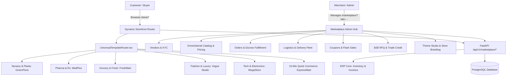

# BusinessOS AI — Complete Marketplace Module Technical & Functional Specification

> **System:** BusinessOS AI Omnichannel Commerce & Multi-Vendor Marketplace  
> **Route Entry Point (Admin/Merchant):** [`frontend/src/routes/_app.marketplace.tsx`](file:///c:/Users/admin/Desktop/NewFolder/frontend/src/routes/_app.marketplace.tsx)  
> **Storefront Entry Point (Customer-Facing):** [`frontend/src/routes/store.tsx`](file:///c:/Users/admin/Desktop/NewFolder/frontend/src/routes/store.tsx)  
> **Backend Router:** [`backend/src/api/v1/marketplace/marketplace_router.py`](file:///c:/Users/admin/Desktop/NewFolder/backend/src/api/v1/marketplace/marketplace_router.py)  
> **Storefront Backend:** [`backend/src/api/v1/storefront.py`](file:///c:/Users/admin/Desktop/NewFolder/backend/src/api/v1/storefront.py)  
> **Database Models:** [`backend/src/models/marketplace.py`](file:///c:/Users/admin/Desktop/NewFolder/backend/src/models/marketplace.py) & [`backend/src/models/storefront.py`](file:///c:/Users/admin/Desktop/NewFolder/backend/src/models/storefront.py)

---

## 1. Technology Stack

The Marketplace and Storefront ecosystem in **BusinessOS AI** is built on modern enterprise web standards:

### Frontend Tech Stack
- **Language & Runtime:** TypeScript (Strict Mode) + React 18+
- **Routing & State:**
  - **TanStack Router:** File-based declarative routing (`createFileRoute`) supporting query parameter tab switches (`/marketplace?tab=...`) and dynamic customer routes (`/store/product/$id`).
  - **TanStack Query (React Query v5):** Server state management, auto-caching, optimistic UI mutations, and stale-while-revalidate data synchronization.
  - **Context Providers:**
    - [`StoreThemeContext.tsx`](file:///c:/Users/admin/Desktop/NewFolder/frontend/src/contexts/StoreThemeContext.tsx): Manages live published theme IDs, brand palette overrides, and sector metadata.
    - [`StoreCartContext.tsx`](file:///c:/Users/admin/Desktop/NewFolder/frontend/src/contexts/StoreCartContext.tsx): Persistent client-side shopping cart with coupon redemption, quantity steppers, and tax calculation.
    - [`rbac-context.tsx`](file:///c:/Users/admin/Desktop/NewFolder/frontend/src/contexts/rbac-context.tsx): Role-based access control guarding administrative features.
- **Styling & UI Aesthetics:**
  - **TailwindCSS & Vanilla CSS Variables:** Sleek dark-mode compatible tokens, glassmorphism (`glass-panel`), and custom gradients.
  - **Framer Motion:** Smooth page mounts, layout animations, drawer reveals, and animated modal backdrops.
  - **Lucide React:** Consistent iconography across admin tables and storefront navigation.
  - **Sonner:** Toast notification popups for real-time order alerts, cart updates, and KYC verification statuses.
  - **Leaflet.js & OpenStreetMap:** Real-time geospatial driver dispatch and live delivery radar tracking.

### Backend Tech Stack
- **Language & Framework:** Python 3.11+ with **FastAPI** (High-performance async ASGI architecture).
- **ORM & Database:**
  - **SQLAlchemy 2.0 (Async):** Asynchronous session handling with declarative models, relationship back-populates, and eager loading (`selectinload`).
  - **PostgreSQL 15+:** High-throughput relational database with UUID primary keys and JSONB storage for polymorphic attributes.
  - **Pydantic v2:** Serialization, request payload schema validation, and OpenAPI documentation.
- **Enterprise ERP Integration:**
  - Automatic ERP Inventory deduction ([`InventoryTransaction`](file:///c:/Users/admin/Desktop/NewFolder/backend/src/models/inventory.py)) upon order placement.
  - Automatic Accounts Receivable (`Invoice` & `InvoiceLine`) creation linking marketplace transactions to central corporate accounting.

---

## 2. Architecture & Request Lifecycle

---

## 3. Specialized Sector Storefront Themes

The platform features **6 distinct, fully functional industry themes** defined in [`storeThemesConfig.ts`](file:///c:/Users/admin/Desktop/NewFolder/frontend/src/data/storeThemesConfig.ts). When a theme is selected and published via the **Marketplace Theme Studio**, [`UniversalTemplateRouter.tsx`](file:///c:/Users/admin/Desktop/NewFolder/frontend/src/components/storefront/UniversalTemplateRouter.tsx) dynamically switches the store's **Header**, **Footer**, **Product Card**, and **Hero Section** across the entire customer storefront (`/store/*`).

| Theme ID | Brand Name | Sector | Color Palette | Key Specialized Functional Features |
| :--- | :--- | :--- | :--- | :--- |
| `nursery_botanics` | **GreenFlora** | Botanical Nursery, Plants & Garden Care | **Primary:** `#1B4D3E` (Forest Green) **Accent:** `#C25E3E` (Terracotta) **Tone:** `#FAF8F5` (Linen Cream) | - Sunlight requirement badges (`Full Sun`, `Low Light`) - Watering frequency tags (`Weekly`, `Bi-weekly`) - Ceramic pot size & color selectors - 7-Day transit plant health replacement guarantee - Free Plant Doctor WhatsApp consultation integration |
| `pharma_medical` | **MedPlus** | Healthcare, Pharmacy & Wellness | **Primary:** `#0284C7` (Sky Blue) **Accent:** `#0D9488` (Clinical Teal) **Tone:** `#F0F9FF` (Surgical White) | - Prescription Rx badge & verified pharmacist audit - Active salt molecule composition display - Dosage pack selectors (Strips, Bottles, Bulk) - Cold-chain refrigerated delivery compliance indicator |
| `modern_fresh` | **FreshMart** | Supermarket, Farm Fresh & Daily Grocery | **Primary:** `#16A34A` (Emerald Green) **Accent:** `#EA580C` (Vibrant Orange) **Tone:** `#FFFFFF` (Pure White) | - Dynamic weight selectors (250g, 500g, 1kg, 5kg) - Farm-to-table origin & organic harvest certificates - Promotional Buy-1-Get-1 (BOGO) ribbons - Sealed freshness preservation guarantee tags |
| `fashion_boutique` | **Vogue Studio** | Fashion, Designer Apparel & Luxury Lifestyle | **Primary:** `#18181B` (Zinc Obsidian) **Accent:** `#E11D48` (Haute Rose) **Tone:** `#FAFAFA` (Off White) | - Editorial lookbooks & look-the-part photo grids - Interactive color swatch circles with live image changes - Size guide & model height/fit recommendation - Minimalist slide-out bag with luxury checkout |
| `mega_market` | **MegaStore** | Electronics, Gadgets, Multi-Category & Hardware | **Primary:** `#0F172A` (Slate Navy) **Accent:** `#2563EB` (Electric Blue) **Tone:** `#F8FAFC` (Ice Grey) | - Amazon/BestBuy-style technical specifications table - Granular customer star ratings & verified buyer badges - Left-side category & brand multi-filter rail - 1-Click "Buy Now" instant checkout buttons |
| `speed_mart` | **ExpressMart** | 10-Minute Hyperlocal Quick Commerce | **Primary:** `#7C3AED` (Vibrant Violet) **Accent:** `#F59E0B` (Lightning Amber) **Tone:** `#FDF4FF` (Lavender Mist) | - 10-Minute countdown timer with live courier GPS - Instant `[- 1 +]` stepper buttons directly on product cards - Mobile-first sticky category pill navigation - Persistent floating bottom cart bar with checkout drawer |

---

## 4. Admin & Merchant Hub: Detailed Breakdown by Tab

The merchant administration interface is routed at [`/marketplace?tab=<tab_name>`](file:///c:/Users/admin/Desktop/NewFolder/frontend/src/routes/_app.marketplace.tsx).

---

### GROUP 1: VENDORS & MERCHANTS
- **Main Frontend Components:** [`Vendors.tsx`](file:///c:/Users/admin/Desktop/NewFolder/frontend/src/components/marketplace/Vendors.tsx) & [`MarketplaceModals.tsx`](file:///c:/Users/admin/Desktop/NewFolder/frontend/src/components/marketplace/MarketplaceModals.tsx)
- **Backend Endpoints:**
  - `GET /api/v1/marketplace/vendors` &rarr; Retrieves list of registered vendors with filters.
  - `POST /api/v1/marketplace/vendors` &rarr; Creates a new merchant profile.
  - `PUT /api/v1/marketplace/vendors/{vendor_id}/kyc` &rarr; Approves, suspends, or rejects vendor KYC.

#### Sub-Tabs & Functionality:
1. **`tab=vendors` (Merchant Master Directory):**
   - **Data Displayed:** Vendor ID (`VND-XXXX`), Company Name, Merchant Category, Status (`Active`, `Pending`, `Suspended`), Rating Stars, Total Orders, Lifetime Revenue, Join Date, Location, Platform Commission Rate %, Escrow Wallet Balance.
   - **Interactive Buttons & Controls:**
     - `+ Add Vendor` &rarr; Opens `AddVendorModal` capturing Business Name, Category, Commission Rate, Location, Email, Phone, Trade License #, and Tax TRN.
     - `Search Input` &rarr; Debounced filtering by vendor name or license.
     - `Category & Status Filters` &rarr; Multi-attribute selector.
     - `View Products` &rarr; Links directly to the vendor's filtered catalog.

2. **`tab=vendor_categories` (Vendor Taxonomies):**
   - **Data Displayed:** Category ID, Category Name, Default Platform Commission % (e.g. 8.5% for Electronics, 15% for Fashion), Active Merchants Count, Total Product Listings, Category Status.
   - **Controls:** Configure category-specific commission rates applied to vendor sales splits.

3. **`tab=vendor_contracts` (Legal & Service Level Agreements):**
   - **Data Displayed:** Contract ID, Vendor Name, Agreement Type (`Standard Merchant`, `Exclusive Enterprise`), Agreed Revenue Share, Effective Dates, SLA Fulfillment Metric (e.g. `98.5% on-time dispatch`), Contract Status (`Active`, `Renewal Pending`).

4. **`tab=vendor_wallet` & `tab=vendor_payouts` (Escrow & Disbursements):**
   - **Data Displayed:** Payout Reference ID, Vendor Name, Disbursed Amount, Payout Method (`WPS Bank Transfer`, `Stripe Wire`, `Direct Debit`), Bank Reference Number, Transfer Date, Status (`Cleared`, `Processing`, `Failed`).
   - **Interactive Buttons:**
     - `Initiate Settlement` &rarr; Opens `CreatePayoutModal` allowing finance managers to disburse accumulated escrow balances to vendor corporate bank accounts.

5. **`tab=vendor_kyc` & `tab=vendor_approvals` (Compliance & Auditing):**
   - **Data Displayed:** Vendor ID, Trade License Number, Tax Registration Number (TRN), Verification Documents, Location, KYC Status (`Pending`, `Approved`, `Rejected`).
   - **Interactive Buttons:**
     - `Approve` (Green Button) &rarr; Sets KYC to `Approved` and updates vendor status to `Active`.
     - `Reject` (Red Button) &rarr; Rejects KYC and suspends store listings.

6. **`tab=vendor_performance` & `tab=vendor_dashboard`:**
   - **Rendered by:** [`VendorDashboard.tsx`](file:///c:/Users/admin/Desktop/NewFolder/frontend/src/components/marketplace/VendorDashboard.tsx)
   - **Data Displayed:** Marketplace KPI Cards (Total Vendors, Active Merchants, Monthly GMV, Total Orders, Platform Net Commission), Revenue Growth YoY charts, Top 5 Performing Merchants, Order Volume graphs.

---

### GROUP 2: MARKETPLACE PRODUCTS & CATALOG
- **Main Frontend Component:** [`MarketplaceProducts.tsx`](file:///c:/Users/admin/Desktop/NewFolder/frontend/src/components/marketplace/MarketplaceProducts.tsx)
- **Backend Endpoints:**
  - `GET /api/v1/marketplace/products` &rarr; Queries omnichannel catalog joined with central ERP inventory.
  - `POST /api/v1/marketplace/products` &rarr; Creates a product listing.
  - `PUT /api/v1/marketplace/products/{product_id}/status` &rarr; Moderates product status (`Approved`, `Pending`, `Rejected`).

#### Sub-Tabs & Functionality:
1. **`tab=marketplace_products` (Omnichannel Catalog):**
   - **Data Displayed:** Product Image thumbnail, Title, Category, Vendor Name, Selling Price, Cost Price, On-Hand Stock, SKU, Approval Status (`Approved`, `Pending Approval`, `Flagged`), Featured Star toggle.
   - **Interactive Buttons & Controls:**
     - `+ Add Product` &rarr; Opens `AddProductModal` with Title, Category, Vendor selection, Price, Cost, Stock, SKU, Description, and Image URL.
     - `Approve Listing` &rarr; Immediately publishes pending vendor submission to the live customer storefront.
     - `Reject Listing` &rarr; Blocks listing from appearing on public search.
     - `Toggle Featured` &rarr; Elevates product to homepage carousel and featured product grids.

2. **`tab=pricing_rules` & `tab=dynamic_pricing` (B2B Volume Tier Pricing):**
   - **Rendered by:** [`B2BPricingRules.tsx`](file:///c:/Users/admin/Desktop/NewFolder/frontend/src/components/marketplace/B2BPricingRules.tsx)
   - **Data Displayed:** Rule ID, Rule Name, Target Customer Tier (`Retail`, `Wholesale VIP`, `Government / Institutional`), Minimum Order Quantity (MOQ), Volume Discount Percentage (e.g. 10-50 units: 5% off; 51-200 units: 12% off; >200 units: 20% off), Active Status.
   - **Interactive Buttons:** `Create Pricing Rule Button` &rarr; Configures automated tiered price adjustments calculated dynamically at checkout.

3. **`tab=rfqs`, `tab=vendor_rfqs` & `tab=quotations` (B2B Request for Quotation):**
   - **Rendered by:** [`MarketplaceRFQ.tsx`](file:///c:/Users/admin/Desktop/NewFolder/frontend/src/components/marketplace/MarketplaceRFQ.tsx)
   - **Data Displayed:** RFQ Number, Required Product/Material, Target Quantity, Buyer Target Price, Submission Deadline, Received Vendor Bids counter, Status (`Open for Bidding`, `Under Evaluation`, `Awarded`).
   - **Interactive Controls:**
     - `Submit RFQ Form` &rarr; Buyers publish bulk requisition specifications.
     - `Vendor Bidding Panel` &rarr; Multiple vendors submit competitive counter-quotes with custom delivery timelines.
     - `Accept Bid Button` &rarr; Awards purchase contract to winning vendor and automatically generates an ERP Purchase Order.

4. **`tab=trade_credit` & `tab=b2b_credit` (Corporate Trade Financing):**
   - **Rendered by:** [`TradeCreditManager.tsx`](file:///c:/Users/admin/Desktop/NewFolder/frontend/src/components/marketplace/TradeCreditManager.tsx)
   - **Data Displayed:** Corporate Buyer Account, Approved Credit Line (e.g. $100,000), Utilized Credit, Available Credit Balance, Payment Terms (`Net 30`, `Net 60`, `Net 90`), Aging Overdue Balance, Credit Risk Rating.
   - **Interactive Controls:** `Adjust Credit Limit` & `Freeze Account`.

---

### GROUP 3: ORDERS, FULFILLMENT & INVOICES
- **Main Frontend Component:** [`MarketplaceOrders.tsx`](file:///c:/Users/admin/Desktop/NewFolder/frontend/src/components/marketplace/MarketplaceOrders.tsx)
- **Backend Endpoints:**
  - `GET /api/v1/marketplace/orders` &rarr; Returns paginated orders with items, vendor mappings, and tracking status.
  - `POST /api/v1/marketplace/orders` &rarr; Creates multi-vendor checkout orders with escrow splits, inventory deduction, and ERP invoice generation.
  - `PUT /api/v1/marketplace/orders/{order_id}/pack` &rarr; Marks items packed in warehouse.
  - `PUT /api/v1/marketplace/orders/{order_id}/dispatch` &rarr; Assigns courier and generates tracking number.
  - `PUT /api/v1/marketplace/orders/{order_id}/deliver` &rarr; Confirms final customer handover.
  - `PUT /api/v1/marketplace/orders/{order_id}/cancel` &rarr; Cancels order and initiates customer refund.

#### Sub-Tabs & Functionality:
1. **`tab=orders` (Central Multi-Vendor Orders Pipeline):**
   - **Data Displayed:** Order ID (`ORD-XXXXX`), Customer Name & Contact, Order Timestamp, Items Breakdown with Vendor attribution, Total Amount, Payment Method (`Credit Card`, `COD`, `Digital Wallet`), Payment Status (`Paid`, `Pending`, `Refunded`), Order Status (`Processing`, `Shipped`, `Delivered`, `Cancelled`), Fulfillment Status (`Pending Pick`, `Packed`, `Dispatched`), Delivery Courier & Tracking Number, Linked ERP Invoice Number.
   - **Interactive Order Actions:**
     - `Pack Order` &rarr; Validates warehouse bin/rack pick list and marks order `Packed`.
     - `Dispatch with Courier` &rarr; Assigns tracking number and updates status to `Shipped`.
     - `Mark as Delivered` &rarr; Records delivery confirmation and releases escrow funds to vendor wallet balances.
     - `Cancel & Refund` &rarr; Restores stock to warehouse inventory and voids invoice.
     - `View Invoice` &rarr; Opens official ERP Tax Invoice linked to the transaction.

2. **`tab=returns`, `tab=refunds` & `tab=cancellations`:**
   - **Data Displayed:** Return Merchandise Authorization (RMA) table with reason codes (Damaged, Defective, Wrong Size), Inspection Audit Status, and Automated Refund disbursement status.

3. **`tab=order_timeline` & `tab=order_tracking`:**
   - Visual milestone progression tracking: `Order Placed` &rarr; `Vendor Confirmed` &rarr; `Warehouse Packed` &rarr; `In Transit with Courier` &rarr; `Out for Delivery` &rarr; `Delivered`.

---

### GROUP 4: LOGISTICS, COURIERS & HYPERLOCAL RADAR
- **Main Frontend Component:** [`DeliveryTracking.tsx`](file:///c:/Users/admin/Desktop/NewFolder/frontend/src/components/marketplace/DeliveryTracking.tsx)
- **Backend Endpoints:**
  - `GET /api/v1/marketplace/delivery-partners` &rarr; Returns integrated courier partner fleets and performance metrics.

#### Sub-Tabs & Functionality:
1. **`tab=delivery_partners` & `tab=drivers` (Fleet Management):**
   - **Data Displayed:** Courier Partner ID, Company Name (e.g. *Aramex, FedEx, DHL, In-House Express*), Active Driver Couriers, Coverage Zones, Customer Rating (e.g. 4.9 Stars), On-Time SLA Compliance % (e.g. 99.1%), Active Live Deliveries, Integration Status.

2. **`tab=delivery_tracking` & `tab=hyperlocal_delivery` (Live Dispatch Map):**
   - **Features:** Embedded Leaflet map showing live delivery pins across the city, active courier route paths, estimated time of arrival (ETA), and dispatch priority queues.

3. **`tab=shipping_rules` & `tab=route_planning`:**
   - Flat rate shipping, free shipping order thresholds (e.g. Free shipping above $50), and geographic distance-based delivery rate calculators.

---

### GROUP 5: PROMOTIONS, COUPONS & LOYALTY
- **Main Frontend Components:** [`_app.marketplace.tsx`](file:///c:/Users/admin/Desktop/NewFolder/frontend/src/routes/_app.marketplace.tsx) & [`MarketplaceModals.tsx`](file:///c:/Users/admin/Desktop/NewFolder/frontend/src/components/marketplace/MarketplaceModals.tsx)
- **Backend Endpoints:**
  - `GET /api/v1/marketplace/coupons` &rarr; Fetches active discount coupons.
  - `POST /api/v1/marketplace/coupons` &rarr; Creates a new promotional campaign.

#### Sub-Tabs & Functionality:
1. **`tab=coupons` & `tab=offers` (Promotions Engine):**
   - **Data Displayed:** Promo Code (e.g. `WELCOME10`, `PLANTLOVER20`), Discount Value (`10% Off`, `Fixed $25 Off`, `Free Shipping`), Minimum Qualifying Order, Redemption Usage Counter (`340 / 1000 Used`), Expiration Date, Status (`Active`, `Expired`).
   - **Interactive Buttons:**
     - `Create Coupon` &rarr; Opens `AddCouponModal` to define discount percentage, minimum spend, expiry date, and usage limits.

2. **`tab=flash_sales` & `tab=campaigns`:**
   - Time-bound flash deals with countdown timers that automatically adjust storefront pricing for selected hours.

3. **`tab=wallet`, `tab=loyalty` & `tab=gift_cards`:**
   - Manages customer digital wallet balances, OSAI loyalty reward coins, and gift card redemption codes.

---

### GROUP 6: MARKETPLACE INTELLIGENCE & ANALYTICS
- **Main Frontend Component:** [`VendorDashboard.tsx`](file:///c:/Users/admin/Desktop/NewFolder/frontend/src/components/marketplace/VendorDashboard.tsx)
- **Backend Endpoints:**
  - `GET /api/v1/marketplace/stats` &rarr; Aggregates real-time marketplace metrics.

#### Sub-Tabs & Functionality:
1. **`tab=demand_forecast` & `tab=vendor_analytics`:**
   - Predictive machine learning forecasting expected product reorder velocity based on seasonal trends and past 90-day sales.
2. **`tab=product_analytics` & `tab=fraud_detection`:**
   - Conversion rate analytics, abandoned cart analytics, and anomaly fraud detection flagging suspicious checkout volume.
3. **`tab=ai_recommendations`:**
   - Automated product recommendation engine cross-selling complementary catalog items.

---

### GROUP 7: STOREFRONT THEME & BRANDING STUDIO
- **Main Frontend Component:** [`MarketplaceThemeStudio.tsx`](file:///c:/Users/admin/Desktop/NewFolder/frontend/src/components/marketplace/MarketplaceThemeStudio.tsx) (793 lines)
- **Backend Endpoints:**
  - `GET /api/v1/marketplace/theme` &rarr; Fetches currently active theme ID, branding, and color configuration.
  - `PUT /api/v1/marketplace/theme` &rarr; Persists live published theme settings to database and config storage.

#### Features & Controls in Theme Studio:
- **Template Card Selector:** Cards for all 6 industry templates (`GreenFlora`, `MedPlus`, `FreshMart`, `Vogue Studio`, `MegaStore`, `ExpressMart`) with badge preview, keywords, and description.
- **Custom Branding Tab:**
  - Store Name input (overrides default brand name).
  - Store Tagline input.
  - Top Announcement Banner text editor (e.g. *Free Shipping over $50 • 24/7 Support*).
  - Customer Support Phone & Email inputs.
- **Color Palette & Styling Tab:**
  - Hex color pickers for **Primary Brand Color**, **Accent Color**, and **Background Tone**.
  - Preset sector palettes for 1-click styling.
- **Device Viewport Toggle:**
  - Alternates interactive live preview between **Desktop View** and **Mobile Smartphone View**.
- **Interactive Live Preview Canvas:**
  - Shows dynamic preview of Header, Search bar, Category pills, Product Card, and Promotional Banner using chosen colors and branding.
- **"Save & Publish to Live Store" Button:**
  - Persists settings to backend API (`PUT /api/v1/marketplace/theme`) and updates client-side `StoreThemeContext`.
- **"Visit Live Storefront" Button:**
  - Opens `/store` in a new browser tab to inspect the published customer-facing store immediately.

---

## 5. Customer-Facing Storefront Ecosystem (`/store/*`)

The public online shopping experience includes complete customer journeys:

| Route Path | Description | Key Features |
| :--- | :--- | :--- |
| [`/store`](file:///c:/Users/admin/Desktop/NewFolder/frontend/src/routes/store.index.tsx) | **Storefront Homepage** | Dynamic Sector Hero section, Category chips, Flash Sale countdown ribbon, Featured Product Grid, Sector-specific USP cards (e.g. Plant Doctor, Prescription Rx, Express Delivery), Customer testimonials, Floating Theme Switcher Dock. |
| [`/store/shop`](file:///c:/Users/admin/Desktop/NewFolder/frontend/src/routes/store.shop.tsx) | **Full Product Catalog** | Multi-attribute search, category multi-filter rail, price range slider, in-stock only toggle, sorting (Price Low/High, Rating, Newest), Grid view. |
| [`/store/product/$id`](file:///c:/Users/admin/Desktop/NewFolder/frontend/src/routes/store.product.$id.tsx) | **Product Details Page (PDP)** | Image zoom gallery, Sector badges (Organic, Rx, Care guides), Pot size / Variant / Strip dosage selector, Dynamic Add to Cart with [- 1 +] stepper, Stock availability badge, Customer reviews. |
| [`/store/cart`](file:///c:/Users/admin/Desktop/NewFolder/frontend/src/routes/store.cart.tsx) | **Shopping Cart** | Cart items list, Promo code coupon redemption field with immediate price reduction, Free shipping progress bar, Subtotal, Tax (VAT/GST), Estimated total. |
| [`/store/checkout`](file:///c:/Users/admin/Desktop/NewFolder/frontend/src/routes/store.checkout.tsx) | **Multi-Step Checkout** | Delivery Address selection, Shipping speed (Hyperlocal 10-Min, Same-Day Express, Standard), Payment options: Credit Card, Cash on Delivery, Digital Wallet, OSAI Coins, B2B Trade Credit. |
| [`/store/thank-you`](file:///c:/Users/admin/Desktop/NewFolder/frontend/src/routes/store.thank-you.tsx) | **Order Confirmation** | Generated Order ID (`ORD-XXXXX`), Courier tracking link, Download Tax Invoice button, Delivery time estimate. |
| [`/store/orders`](file:///c:/Users/admin/Desktop/NewFolder/frontend/src/routes/store.orders.tsx) | **Customer Orders History** | Real-time order progress timeline, reorder 1-click button, cancellation and return request buttons. |
| [`/store/wallet`](file:///c:/Users/admin/Desktop/NewFolder/frontend/src/routes/store.wallet.tsx) | **Digital Wallet & Rewards** | Prepaid wallet balance, OSAI Reward coins balance, Top-up balance modal, Transaction history ledger. |
| [`/store/wishlist`](file:///c:/Users/admin/Desktop/NewFolder/frontend/src/routes/store.wishlist.tsx) | **Customer Wishlist** | Saved favorite items with 1-click "Move to Cart" button. |
| [`/store/search`](file:///c:/Users/admin/Desktop/NewFolder/frontend/src/routes/store.search.tsx) | **Search Results Page** | Instant query matching across product names, categories, and tags. |
| [`/store/account`](file:///c:/Users/admin/Desktop/NewFolder/frontend/src/routes/store.account.tsx) & [`/store/addresses`](file:///c:/Users/admin/Desktop/NewFolder/frontend/src/routes/store.addresses.tsx) | **Customer Profile & Address Book** | Manage personal information, saved home/office shipping addresses, default payment methods. |
| [`/store/about`](file:///c:/Users/admin/Desktop/NewFolder/frontend/src/routes/store.about.tsx) & [`/store/contact`](file:///c:/Users/admin/Desktop/NewFolder/frontend/src/routes/store.contact.tsx) | **Brand & Help Pages** | Company story, mission, customer service enquiry form, WhatsApp helpline link. |

---

## 6. Mathematical Formulas & Business Calculations

### 1. Multi-Vendor Order Split & Platform Commission
When a customer places an order containing items from multiple independent vendors:
$$\text{Item Total} = \text{Unit Price} \times \text{Quantity}$$
$$\text{Platform Commission} = \text{Item Total} \times \left(\frac{\text{Vendor Commission Rate}}{100}\right)$$
$$\text{Vendor Escrow Net Payout} = \text{Item Total} - \text{Platform Commission}$$
The $\text{Vendor Escrow Net Payout}$ is credited to `MarketplaceVendor.escrow_balance` and becomes available for withdrawal once order status reaches `Delivered`.

### 2. Tiered B2B Volume Pricing Rule
$$\text{Final Unit Price} = \begin{cases} 
P & \text{if } Q < Q_1 \\
P \times (1 - D_1) & \text{if } Q_1 \le Q < Q_2 \\
P \times (1 - D_2) & \text{if } Q \ge Q_2 
\end{cases}$$
*(Where $P$ = base price, $Q$ = quantity, $D$ = discount rate).*

### 3. Promotional Coupon Discounts
- **Percentage Discount:**
  $$\text{Discount Amount} = \min\left(\text{Subtotal} \times \frac{\text{Discount Value}}{100}, \;\text{Max Discount Cap}\right)$$
- **Fixed Amount Discount:**
  $$\text{Discount Amount} = \min(\text{Discount Value}, \;\text{Subtotal})$$
- Applied only if $\text{Subtotal} \ge \text{Min Order Amount}$.

### 4. B2B Trade Credit Availability
$$\text{Available Credit} = \text{Approved Credit Line} - (\text{Utilized Unpaid Invoices} + \text{Pending Orders})$$
If order total exceeds $\text{Available Credit}$, trade credit checkout is disabled with an account limit warning.

---

## 7. Master Function & Component Directory

| Function / Component | File Location | Responsibility |
| :--- | :--- | :--- |
| `MarketplaceModule` | [`_app.marketplace.tsx`](file:///c:/Users/admin/Desktop/NewFolder/frontend/src/routes/_app.marketplace.tsx#L161) | Central administrative router switching between vendor, order, logistics, catalog, and theme studio tabs. |
| `MarketplaceThemeStudio` | [`MarketplaceThemeStudio.tsx`](file:///c:/Users/admin/Desktop/NewFolder/frontend/src/components/marketplace/MarketplaceThemeStudio.tsx#L91) | Interactive studio for switching sector themes, customizing brand palettes, and previewing stores. |
| `DynamicStoreHeader` | [`UniversalTemplateRouter.tsx`](file:///c:/Users/admin/Desktop/NewFolder/frontend/src/components/storefront/UniversalTemplateRouter.tsx#L41) | Dynamically renders industry-specific navigation headers based on active theme. |
| `DynamicProductCard` | [`UniversalTemplateRouter.tsx`](file:///c:/Users/admin/Desktop/NewFolder/frontend/src/components/storefront/UniversalTemplateRouter.tsx#L86) | Renders tailored product card components with sector badges and variant selectors. |
| `create_vendor` | [`marketplace_router.py`](file:///c:/Users/admin/Desktop/NewFolder/backend/src/api/v1/marketplace/marketplace_router.py#L101) | Persists new vendor profile with trade license, tax TRN, and commission configuration. |
| `update_vendor_kyc` | [`marketplace_router.py`](file:///c:/Users/admin/Desktop/NewFolder/backend/src/api/v1/marketplace/marketplace_router.py#L125) | Approves or rejects merchant KYC compliance records. |
| `create_order` | [`marketplace_router.py`](file:///c:/Users/admin/Desktop/NewFolder/backend/src/api/v1/marketplace/marketplace_router.py#L386) | Handles multi-vendor order checkout, splits payouts, decrements physical warehouse inventory, and generates ERP tax invoices. |
| `dispatch_order` | [`marketplace_router.py`](file:///c:/Users/admin/Desktop/NewFolder/backend/src/api/v1/marketplace/marketplace_router.py#L606) | Assigns delivery courier tracking numbers and updates logistics timeline. |
| `create_payout` | [`marketplace_router.py`](file:///c:/Users/admin/Desktop/NewFolder/backend/src/api/v1/marketplace/marketplace_router.py#L741) | Executes escrow balance payouts to merchant bank accounts. |
| `get_theme` / `save_theme`| [`marketplace_router.py`](file:///c:/Users/admin/Desktop/NewFolder/backend/src/api/v1/marketplace/marketplace_router.py#L998) | Reads and saves active theme configurations across the platform. |
