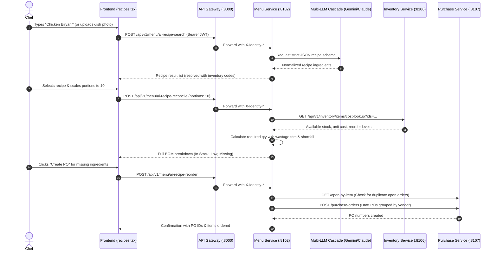
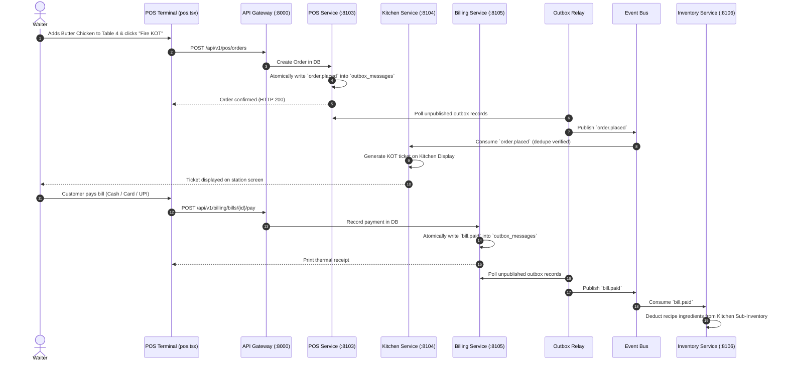

# End-to-End Integration, Data Flows & Production Roadmap

This document details how the **RestaurantOS Frontend and Backend connect**, the end-to-end request lifecycles, cross-service communication patterns, and the comprehensive master checklist of what is done vs. what needs to be done.

---

## 1. How Frontend & Backend Connect

### 1.1. Network & Reverse Proxy Architecture

All frontend API calls are routed through the **API Gateway** (`http://127.0.0.1:8000`). The browser never talks directly to individual microservice ports.

```
┌────────────────────────────────────────────────────────┐
│             Frontend SPA (Port 5173 / 3000)            │
└──────────────────────────┬─────────────────────────────┘
                           │ HTTP + Authorization: Bearer <JWT>
                           ▼
┌────────────────────────────────────────────────────────┐
│              API Gateway (Port 8000 / 8010)            │
│  1. Verifies JWT token signature and expiry             │
│  2. Extracts tenant_id, user_id, permissions, roles     │
│  3. Module Gating: checks if tenant has active license  │
│  4. Forwards request with X-Identity-* headers         │
└──────┬───────────────────┬──────────────────────┬──────┘
       │                   │                      │
       ▼ :8102             ▼ :8103                ▼ :8106
┌──────────────┐    ┌──────────────┐       ┌──────────────┐
│ Menu Service │    │ POS Service  │       │  Inventory   │
│ (Postgres)   │    │ (Postgres)   │       │  (Postgres)  │
└──────────────┘    └──────────────┘       └──────────────┘
```

### 1.2. The Trusted Identity Forwarding Contract

When a request passes the Gateway, it injects standardized identity headers:
- `X-Identity-Tenant-Id`: Active tenant UUID.
- `X-Identity-User-Id`: Authenticated user UUID.
- `X-Identity-Permissions`: Comma-separated list of granular permissions (`view:recipes`, `manage:orders`, `*`).
- `X-Identity-Is-Owner`: Boolean flag indicating tenant owner privileges.
- `X-Identity-Active-Outlet`: Currently active restaurant outlet UUID.

Each downstream microservice reads these headers using [`identity.py`](file:///c:/Users/abhil/Desktop/restaurant/backend/src/services/shared/identity.py). This guarantees zero redundant token decoding while enforcing multi-tenant isolation at the database layer.

---

## 2. End-to-End Workflow Walkthroughs

### Workflow 1: AI Recipe Search → Inventory BOM Reconciliation → Restock PO Creation



---

### Workflow 2: POS Order Placement → Kitchen KOT → Settlement → Stock Deduction



---

### Workflow 3: Platform Super Admin Onboarding Spice9 Restaurant

1. **Super Admin Log In**: Platform administrator logs into [`platform.tsx`](file:///c:/Users/abhil/Desktop/restaurant/frontend/src/routes/platform.tsx).
2. **Tenant Creation**: Admin calls `POST /api/v1/platform/tenants` with name `"Spice9 Restaurant"`, slug `"spice9"`, and default admin email.
3. **Module Licensing**:
   - By default, core services (Auth, Organization, Menu, Billing, Inventory) are enabled.
   - Admin enables plugin modules: POS, Kitchen, Loyalty, CRM, and Salon/Gym if applicable.
4. **Dynamic Access Enforcement**:
   - The Gateway checks the tenant module license on every call. If Spice9 has not paid for Kitchen KDS, the gateway rejects `/api/v1/kitchen` calls with `403 Module Suspended`, while keeping POS and Billing fully operational.

---

## 3. Master Project Status & Checklist

### ✅ What is Fully Completed & Tested

| Feature Area | Component | Verification Status |
| :--- | :--- | :--- |
| **Microservices Architecture** | All 14 microservice FastAPI apps + registry descriptors | Verified independent execution |
| **API Gateway** | Reverse proxy, JWT decoding, module gating | Live HTTP tests passing |
| **AI Recipe Search** | Multi-LLM provider cascade (Gemini, Claude, OpenAI) | Strict JSON schema verified |
| **Multimodal Inputs** | Image base64 upload + dish query parsing | Tested with pure parser unit tests |
| **BOM Calculation** | Portions scaling ($N$ portions) + wastage trim math | Verified with 12 pytest unit tests |
| **Procurement Automation** | 1-Click Draft PO & PR generation by vendor | Verified with idempotency check (`resp7.json`) |
| **Fallback & Degradation** | Zero-downtime catalog fallback when API keys are empty | Verified with `test_recipe_ai_degrade.py` |
| **Transactional Outbox** | Outbox tables and polling relays in 4 ledger services | Verified in Billing, POS, Kitchen, Inventory |
| **Event Deduplication** | `consumed_events` ledger for idempotent message handling | Implemented in `event_bus/dedupe.py` |
| **Interactive POS** | Table floor plan, live cart, modifier popups, split payment | Implemented in `pos.tsx` |
| **Kitchen Display (KDS)** | Multi-station KOT cards, color-coded timer urgency | Implemented in `kitchen.tsx` |
| **Platform Super Admin** | Tenant onboarding, dynamic RBAC, module licensing | Implemented in `platform/` & `platform.tsx` |

---

### ⏳ What Needs to Be Done (Next Steps for Production)

#### 1. Start Redis for Distributed Event Bus (Immediate)
- **Current State**: The Event Bus is operating in in-process asyncio fallback mode.
- **Action Required**: Launch Redis on port `6379` using the root script [`start_redis.bat`](file:///c:/Users/abhil/Desktop/restaurant/start_redis.bat).
- **Result**: Cross-service outbox relays running in separate OS processes will distribute messages across all microservices.

#### 2. Real-Time Push for KDS (WebSockets / SSE)
- **Current State**: The Kitchen display polls `kitchenService.getActiveKots()` periodically.
- **Action Required**: Wire a Server-Sent Events (SSE) stream through the Gateway (`/api/v1/kitchen/events/stream`) connected to the Redis `kot.fired` topic for instant real-time kitchen card pops.

#### 3. Hardware Thermal Printer Protocol (ESC/POS)
- **Current State**: Thermal receipts render in custom HTML and can be printed via browser print dialog.
- **Action Required**: Connect WebUSB / WebHID direct raw print commands for 58mm and 80mm thermal receipt printers (Petpooja / MyBillBook format).

#### 4. Automated Alembic Migration Orchestrator
- **Current State**: Services create their own database schemas at startup via SQLAlchemy metadata.
- **Action Required**: Unify the Alembic migration scripts so a single command (`alembic upgrade head`) migrates all 14 isolated databases on new deployments.
