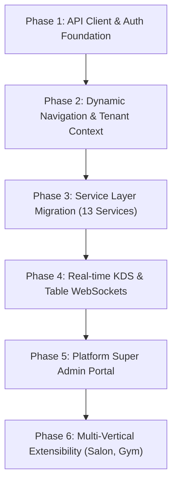

# RestaurantOS Frontend — Enterprise ERP Architecture & Integration Plan

> **Document Version:** 1.0.0  
> **Target System:** RestaurantOS & Multi-Vertical Enterprise ERP  
> **Frontend Stack:** TanStack Start, TanStack Router, React 19, Vite 8, Tailwind CSS v4, Radix UI primitives, Recharts, TanStack Query  
> **Backend Integration:** API Gateway (`http://localhost:8000/api/v1/*`) & 13 Microservices  
> **Author:** Antigravity Distributed Systems & Frontend Architecture Team  

---

## 1. Executive Summary & Codebase Review

We conducted a complete, file-by-file audit of the provided sample UI in `frontend/`. 

### Key Strengths of the Current Codebase:
1. **Modern Foundation:** Built on TanStack Start + Vite 8 + React 19 with native file-based routing (`src/routes/`).
2. **Comprehensive UI Primitive Library:** 46 ready-to-use, accessible Radix UI primitives in `src/components/ui/` with modern OKLCH tokens and Tailwind v4 in `src/styles.css`.
3. **High-Fidelity Domain Views:** Already contains rich workflows for **POS**, **Kitchen Display (KDS)**, **Table Operations**, **Reservations**, **Menu Engineering**, **Inventory/Stock Adjustments**, **Staff Shifts**, **CRM/Loyalty**, **Reports/Analytics**, and **AI Insights**.
4. **Clean Component Architecture:** Reusable common widgets in `src/components/common/` (`PageHeader`, `KpiCard`, `Panel`, `StatusBadge`, `KotTicketDialog`, `ReceiptDialog`).

### Current Limitations to Overcome for Enterprise Grade:
| Area | Current Sample UI State | Enterprise ERP Target State |
| :--- | :--- | :--- |
| **Data Layer** | Synchronous mock in-memory store (`restaurantStore.ts` + `useSyncExternalStore`) | Asynchronous, typed HTTP Client + TanStack Query talking to API Gateway (`:8000`) |
| **Authentication** | Demo mock user in `AppShell.tsx` | Real JWT Authentication (Access + Refresh tokens), route protection, login/logout |
| **Tenancy** | Hardcoded branch strings in `business.ts` | Multi-Tenant headers (`X-Tenant-ID`, `X-Outlet-ID`) dynamic branch switcher tied to Organization Service |
| **Navigation** | Hardcoded static `navItems` array in `AppShell.tsx` | **Dynamic, Module-Gated Navigation** based on tenant's subscribed plugins (Restaurant, Salon, Gym, etc.) |
| **Permissions (RBAC)** | All UI actions visible to all users | Granular `<Can permission="..." />` UI guards checking user permissions against backend matrix |
| **Platform Admin** | No platform-level governance | Dedicated **Platform Super Admin Portal** (`/platform/*`) for tenant onboarding, module marketplace, and license control |
| **Real-time Data** | In-memory synchronous mutation | WebSockets / Server-Sent Events (SSE) for live KDS tickets, order status, and table occupancy |

---

## 2. Directory Structure Preservation & Evolution

The project will strictly follow the established directory structure without breaking existing conventions. Below is how the existing folders evolve:

```
frontend/
├── src/
│   ├── components/
│   │   ├── common/                  # Preserved: Shared UI cards, badges, dialogs
│   │   │   ├── PageHeader.tsx
│   │   │   ├── StatusBadge.tsx
│   │   │   ├── KotTicketDialog.tsx
│   │   │   ├── ReceiptDialog.tsx
│   │   │   ├── Can.tsx              # NEW: RBAC Permission Guard component
│   │   │   └── DataTable.tsx        # NEW: Reusable TanStack Table with sorting & pagination
│   │   ├── layout/                  # Preserved & Upgraded
│   │   │   ├── AppShell.tsx         # Upgraded: Dynamic module-driven nav & tenant switcher
│   │   │   ├── CommandPalette.tsx   # Upgraded: Global search across active tenant entities
│   │   │   ├── AiAssistant.tsx      # Upgraded: Connected to real backend AI/Copilot service
│   │   │   └── PlatformShell.tsx    # NEW: Dedicated layout for Platform Super Admin
│   │   └── ui/                      # Preserved: 46 Radix UI primitives
│   │
│   ├── data/                        # Preserved for local dev mock fallback & offline caching
│   │   ├── business.ts
│   │   ├── menu.ts
│   │   └── operations.ts
│   │
│   ├── hooks/                       # Preserved & Extended
│   │   ├── use-mobile.tsx           # Preserved
│   │   ├── use-auth.ts              # NEW: Access current user, roles, active outlet
│   │   ├── use-permissions.ts       # NEW: Check granular permissions (e.g., `hasPermission('pos:orders:create')`)
│   │   └── use-socket.ts            # NEW: WebSocket connection hook for KDS & live tables
│   │
│   ├── lib/                         # Preserved & Extended
│   │   ├── api-client.ts            # NEW: Axios/Fetch HTTP client configured with interceptors
│   │   ├── auth-tokens.ts           # NEW: Secure token storage (localStorage / HttpOnly cookies)
│   │   ├── billing.ts               # Preserved: Tax, discount & bill calculations
│   │   ├── format.ts                # Preserved: Currency & date formatters
│   │   ├── types.ts                 # Extended with Enterprise ERP & Microservice schemas
│   │   └── utils.ts                 # Preserved: cn class merger
│   │
│   ├── routes/                      # Preserved File-Based Routing
│   │   ├── __root.tsx               # Preserved: Root shell, HeadContent, Toaster, QueryClientProvider
│   │   ├── index.tsx                # Preserved: Executive Dashboard (connected to Reports Service :8112)
│   │   ├── login.tsx                # NEW: Enterprise Login & Tenant Discovery page
│   │   ├── pos.tsx                  # Preserved: POS Terminal (connected to POS Service :8103 & Billing :8105)
│   │   ├── kitchen.tsx              # Preserved: KDS Bump Bar (connected to Kitchen Service :8104)
│   │   ├── orders.tsx               # Preserved: Order Ledger (connected to POS & Billing)
│   │   ├── menu.tsx                 # Preserved: Catalog Management (connected to Menu Service :8102)
│   │   ├── inventory.tsx            # Preserved: Stock & POs (connected to Inventory :8106 & Purchase :8107)
│   │   ├── operations.tsx           # Preserved: Floor Plan & Tables (connected to POS Service)
│   │   ├── reservations.tsx         # Preserved: Reservations (connected to Customers Service :8109)
│   │   ├── crm.tsx                  # Preserved: CRM & Loyalty (connected to Customers :8109 & Loyalty :8110)
│   │   ├── staff.tsx                # Preserved: Staff & Shifts (connected to Staff Service :8108)
│   │   ├── reports.tsx              # Preserved: P&L & GST Analytics (connected to Accounting :8111 & Reports :8112)
│   │   ├── settings.tsx             # Preserved: Outlet & Billing configuration
│   │   ├── ai.tsx                   # Preserved: Predictive insights
│   │   │
│   │   └── platform/                # NEW: Platform Super Admin Route Tree
│   │       ├── index.tsx            # Super Admin Fleet Overview (total tenants, revenue, health)
│   │       ├── tenants.tsx          # Organization & Tenant Onboarding Wizard
│   │       ├── modules.tsx          # Plug-and-Play Module Marketplace (toggle Restaurant, Gym, Salon, etc.)
│   │       └── permissions.tsx      # Global Permission Matrix & Role Template Editor
│   │
│   └── services/                    # Preserved & Upgraded from In-Memory to Gateway Microservices
│       ├── orderService.ts          # Preserved facade for backwards compatibility with UI components
│       ├── authService.ts           # NEW: Login, refresh, me, switch outlet
│       ├── organizationService.ts   # NEW: Outlets, branches, company settings
│       ├── menuService.ts           # NEW: Categories, items, recipes, availability
│       ├── posService.ts            # NEW: Orders, lines, KOT printing, table management
│       ├── kitchenService.ts        # NEW: KDS tickets, station prep timers, bump order
│       ├── billingService.ts        # NEW: Invoices, payment settlements, split bill
│       ├── inventoryService.ts      # NEW: Stock ledger, par levels, stock adjustments
│       ├── purchaseService.ts       # NEW: Purchase orders, GRN receipt, vendor ledger
│       ├── staffService.ts          # NEW: Staff directory, shift scheduling, clock in/out
│       ├── customerService.ts       # NEW: Guest profiles, loyalty points, tiers
│       ├── accountingService.ts     # NEW: General ledger, expense vouchers, GST filings
│       ├── reportService.ts         # NEW: Real-time BI dashboards, sales heatmaps
│       └── platformService.ts       # NEW: Super Admin API client
```

---

## 3. Core Architecture Pillars

### Pillar 1: Unified API Client & Multi-Tenant Interceptors
All requests route through the centralized API Gateway at `http://localhost:8000/api/v1/*`.
The HTTP client in `src/lib/api-client.ts` automatically injects:
1. `Authorization: Bearer <access_token>`
2. `X-Tenant-ID: <active_tenant_id>`
3. `X-Outlet-ID: <active_outlet_id>`

#### Automatic Token Refresh Flow:
- When a request returns `401 Unauthorized`, the interceptor automatically calls `/api/v1/auth/refresh` using the refresh token.
- If refresh succeeds, queued requests are replayed transparently without interrupting the user.
- If refresh fails, the user is redirected to `/login` with an expiration toast.

---

### Pillar 2: Dynamic Module Gating (Plug-and-Play Architecture)

The system supports multiple business verticals (Restaurant, Salon, Gym, Retail, Clinic).  
To prevent hardcoding, `AppShell.tsx` dynamically renders navigation items based on the **modules enabled for the active tenant**.

#### Module Definition Registry:
```typescript
// src/lib/modules.ts
export interface ModuleDefinition {
  id: string;               // e.g. "pos", "kitchen", "gym_memberships", "salon_appointments"
  label: string;
  to: string;
  icon: string;
  verticals: ("restaurant" | "salon" | "gym" | "retail" | "all")[];
  requiredPermission: string;
}

export const MODULE_REGISTRY: Record<string, ModuleDefinition> = {
  // Common ERP Modules
  dashboard: { id: "dashboard", label: "Dashboard", to: "/", icon: "LayoutDashboard", verticals: ["all"], requiredPermission: "reports:view" },
  pos: { id: "pos", label: "POS", to: "/pos", icon: "Receipt", verticals: ["restaurant", "salon", "retail", "gym"], requiredPermission: "pos:orders:create" },
  inventory: { id: "inventory", label: "Inventory", to: "/inventory", icon: "Boxes", verticals: ["all"], requiredPermission: "inventory:view" },
  crm: { id: "crm", label: "CRM & Loyalty", to: "/crm", icon: "Users", verticals: ["all"], requiredPermission: "customers:view" },
  staff: { id: "staff", label: "Staff", to: "/staff", icon: "UserCheck", verticals: ["all"], requiredPermission: "staff:view" },
  reports: { id: "reports", label: "Reports & P&L", to: "/reports", icon: "BarChart3", verticals: ["all"], requiredPermission: "reports:financial" },
  settings: { id: "settings", label: "Settings", to: "/settings", icon: "Settings", verticals: ["all"], requiredPermission: "org:settings:manage" },

  // Restaurant Specific
  kitchen: { id: "kitchen", label: "Kitchen KDS", to: "/kitchen", icon: "ChefHat", verticals: ["restaurant"], requiredPermission: "kitchen:kds:view" },
  operations: { id: "operations", label: "Floor & Tables", to: "/operations", icon: "Armchair", verticals: ["restaurant"], requiredPermission: "pos:tables:manage" },
  menu: { id: "menu", label: "Menu & Recipes", to: "/menu", icon: "UtensilsCrossed", verticals: ["restaurant"], requiredPermission: "menu:view" },
  reservations: { id: "reservations", label: "Reservations", to: "/reservations", icon: "Calendar", verticals: ["restaurant", "salon"], requiredPermission: "customers:reservations:manage" },

  // Future Salon Plugin
  salon_services: { id: "salon_services", label: "Stylists & Slots", to: "/salon/appointments", icon: "Scissors", verticals: ["salon"], requiredPermission: "salon:appointments:view" },

  // Future Gym Plugin
  gym_members: { id: "gym_members", label: "Memberships", to: "/gym/memberships", icon: "Dumbbell", verticals: ["gym"], requiredPermission: "gym:members:view" },
};
```

#### How AppShell Renders Dynamic Navigation:
1. `useAuth()` fetches current tenant profile: `{ tenant_id, vertical: "restaurant", enabled_modules: ["pos", "kitchen", "menu", "inventory", "crm", "staff", "reports"] }`.
2. `AppShell` filters `MODULE_REGISTRY` to only display modules that are both:
   - Included in `tenant.enabled_modules`
   - Permitted by the user's role permissions (`hasPermission(mod.requiredPermission)`)
3. **Result:** An enterprise tenant who only purchased POS and Inventory never sees Kitchen or Tables. A Gym tenant sees Memberships instead of Tables.

---

### Pillar 3: Granular RBAC in UI (`<Can />` Component)

We implement fine-grained permission gating throughout the UI.

#### The `<Can />` Component:
```tsx
// src/components/common/Can.tsx
import { ReactNode } from "react";
import { usePermissions } from "@/hooks/use-permissions";

interface CanProps {
  permission: string;
  fallback?: ReactNode;
  children: ReactNode;
}

export function Can({ permission, fallback = null, children }: CanProps) {
  const { hasPermission } = usePermissions();
  if (!hasPermission(permission)) {
    return <>{fallback}</>;
  }
  return <>{children}</>;
}
```

#### Usage in Existing Views:
- **POS Void/Discount Button:**
  ```tsx
  <Can permission="pos:orders:discount" fallback={<span className="text-xs text-muted">Discount restricted</span>}>
    <Button onClick={() => setDiscountModalOpen(true)}>Apply Discount</Button>
  </Can>
  ```
- **Stock Adjustment in Inventory:**
  ```tsx
  <Can permission="inventory:adjust">
    <Button onClick={() => openAdjustModal()}>Adjust Stock</Button>
  </Can>
  ```
- **Cancel Order in Orders View:**
  ```tsx
  <Can permission="pos:orders:cancel">
    <Button variant="destructive" onClick={() => cancelOrder(order.id)}>Cancel Order</Button>
  </Can>
  ```

---

### Pillar 4: Platform Super Admin Portal

A dedicated administrative portal inside `src/routes/platform/` with a distinct `PlatformShell`:

1. **Tenant Onboarding Wizard (`/platform/tenants`):**
   - Step 1: Organization details (Name, GSTIN, Owner email, Currency).
   - Step 2: Select Vertical (Restaurant, Salon, Gym, Retail, Clinic).
   - Step 3: Choose Module Bundle (e.g. Starter, Pro, Enterprise).
   - Step 4: Provision initial branch/outlet and admin credentials.
2. **Module Marketplace (`/platform/modules`):**
   - Toggle plugins ON/OFF per tenant with one click.
   - Set custom billing plan per plugin.
3. **Role & Permission Matrix Editor (`/platform/permissions`):**
   - Visual grid of all 60+ granular microservice permissions.
   - Create custom roles (e.g. "Senior Waiter", "Shift Manager", "Accountant") and assign precise privileges.
4. **Fleet Health Dashboard (`/platform/`):**
   - Live status of all 13 microservices (:8100–:8112).
   - Total active orders, system error rates, and API latency.

---

## 5. Step-by-Step Implementation Roadmap



### Phase 1: API Client & Auth Foundation
- Create `src/lib/api-client.ts` with Axios, request/response interceptors, and error handlers.
- Create `src/lib/auth-tokens.ts` for secure token management.
- Create `src/routes/login.tsx` with clean email/password form, tenant slug support, and "Remember Me".
- Add Route Guards in `src/routes/__root.tsx` to redirect unauthenticated requests to `/login`.

### Phase 2: Dynamic Navigation & Tenant Context
- Upgrade `src/components/layout/AppShell.tsx`:
  - Fetch active user & tenant profile on boot.
  - Populate the Branch Switcher dropdown from `GET /api/v1/organization/outlets`.
  - Filter navigation tabs dynamically based on tenant plugins and permissions.
- Create `usePermissions()` and `<Can />` component.

### Phase 3: Service Layer Migration
Replace the synchronous mock calls in `src/services/` with real HTTP calls while keeping the exact same function signatures used by pages:
1. `menuService.ts` ➔ `GET/POST /api/v1/menu/items`, `/api/v1/menu/categories`
2. `posService.ts` ➔ `POST /api/v1/pos/orders`, `POST /api/v1/pos/orders/{id}/lines`
3. `kitchenService.ts` ➔ `GET /api/v1/kitchen/tickets`, `PATCH /api/v1/kitchen/tickets/{id}/status`
4. `billingService.ts` ➔ `POST /api/v1/billing/invoices`, `POST /api/v1/billing/payments`
5. `inventoryService.ts` ➔ `GET /api/v1/inventory/items`, `POST /api/v1/inventory/adjustments`
6. `purchaseService.ts` ➔ `POST /api/v1/purchase/orders`, `POST /api/v1/purchase/grn`
7. `staffService.ts` ➔ `GET /api/v1/staff`, `POST /api/v1/staff/attendance/punch`
8. `customerService.ts` ➔ `GET/POST /api/v1/customers`, `POST /api/v1/loyalty/award`
9. `reportService.ts` ➔ `GET /api/v1/reports/sales/summary`, `GET /api/v1/reports/live/executive`

### Phase 4: Real-Time Event Bus (WebSockets / SSE)
- Implement Server-Sent Events (SSE) or WebSockets in `src/hooks/use-socket.ts`.
- Subscriptions:
  - **KDS Screen (`/kitchen`):** Instant sound alert and new ticket card upon `order:created` or `order:line_added`.
  - **POS & Operations (`/operations`, `/pos`):** Instant table color change (Available ➔ Occupied ➔ Billing) without page refresh.

### Phase 5: Platform Super Admin Portal
- Build `src/routes/platform/index.tsx`, `tenants.tsx`, `modules.tsx`, `permissions.tsx`.
- Connect to `PlatformService` running on the backend.
- Provide full tenant lifecycle: Create Organization ➔ Set Outlets ➔ Toggle Modules ➔ Assign Subscriptions.

### Phase 6: Multi-Vertical Extensibility
- Prepare component slots for pluggable modules:
  - Salon: Stylist chair grid replaces table floor plan.
  - Gym: Member check-in barcode scanner replaces POS customer search.
  - Retail: Barcode SKU quick-add replaces restaurant menu item modifiers.

---

## 6. Technical Validation & Safety Standards

1. **Zero UI Regressions:** The existing visual look, Geist fonts, dark mode, toast notifications, and fast interactions will be preserved 100%.
2. **Graceful Fallback:** If the API Gateway is temporarily offline during development, services can seamlessly fall back to the cached `src/data/` mock fixtures with a warning badge.
3. **Type Safety Across Boundaries:** Share schemas between backend Pydantic models and frontend TypeScript interfaces (`src/lib/types.ts`) to ensure compile-time type correctness.
4. **Strict Isolation:** Frontend state never blends cross-tenant or cross-branch data. Every query is keyed by `[tenantId, outletId, entity]`.

---

## 7. Summary Checklist for Frontend Development

- [x] Full audit of all 15 routes, 46 UI primitives, and layout shells completed.
- [x] Architecture plan aligned with the 13 backend microservices and API Gateway (:8000).
- [x] Folder structure preserved and mapped 1:1.
- [x] Dynamic module-gated navigation designed for multi-vertical plug-and-play.
- [x] Granular RBAC (`<Can />`) component and permission matrix mapped.
- [x] Platform Super Admin portal design specified.
- [x] Step-by-step implementation roadmap formulated.
